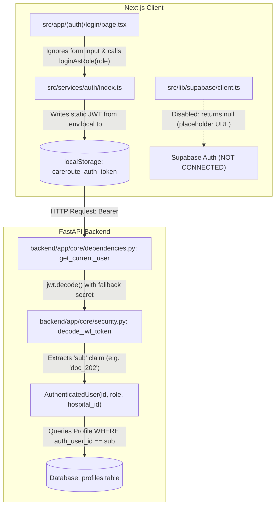
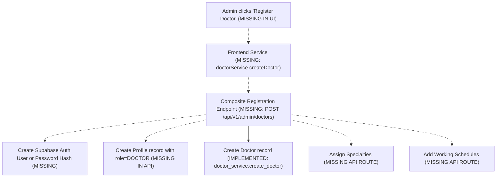
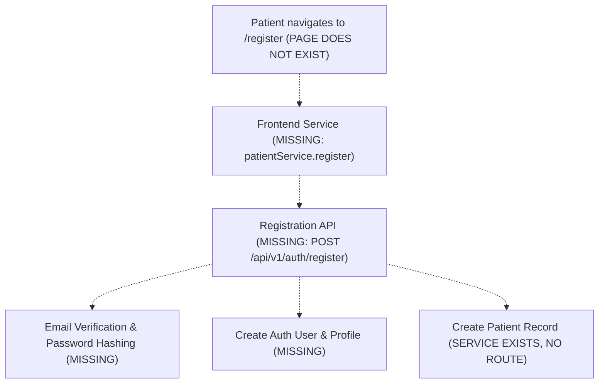

# CareRoute-X Authentication and Registration Architecture Audit

**Date:** October 22, 2026  
**Auditor:** Antigravity Agentic Pair Programmer  
**Project Root:** `D:\medcon5`  
**Scope:** Authentication, Authorization, Doctor Registration, Patient Registration, Database Architecture & Production Hardening  
**Audit Type:** Strict Read-Only Architecture & Security Flow Audit  
**Report Destination:** `D:\medcon5\reports\authentication_registration_audit.md`  

---

## Executive Summary

This audit assesses the authentication and user registration architecture of CareRoute-X. It determines what is currently implemented, what is simulated via development fixtures, and what is missing to support secure, genuine doctor and patient registration in production.

### Core Verdict: **SIMULATED AUTHENTICATION & PARTIAL REGISTRATION BACKBONE**

* **Authentication (SIMULATED / MOCK SHORTCUT):**
  * There is **no live authentication provider** connected. The frontend Supabase client explicitly disables itself because `NEXT_PUBLIC_SUPABASE_URL` is set to a placeholder (`placeholder-project.supabase.co`).
  * FastAPI does **not** expose any login, signup, or token-generation endpoints (`/auth/login`, `/auth/register`, etc.).
  * Login is simulated on the frontend via [`src/services/auth/index.ts`](file:///D:/medcon5/src/services/auth/index.ts) by injecting static, pre-signed JSON Web Tokens (`pat_101`, `doc_202`, `adm_303`) into browser `localStorage`. Form inputs on [`src/app/(auth)/login/page.tsx`](file:///D:/medcon5/src/app/(auth)/login/page.tsx) are completely ignored upon submission.
* **Authorization (MOSTLY COMPLETE with Specific IDOR Gaps):**
  * Backend endpoints enforce role checks (`require_patient`, `require_doctor`, `require_admin`). Appointments, operational queues, and triage session modifications strictly enforce caller ownership.
  * **Critical IDOR Gap:** `GET /api/v1/patients/{patient_id}` only enforces ownership if the caller has role `patient`. Any authenticated doctor can retrieve full demographic and emergency contact records for any patient across any hospital without tenant or appointment boundaries.
* **Doctor Registration (PARTIAL BACKEND / MISSING FRONTEND):**
  * The backend provides `POST /api/v1/doctors` (admin only), but this endpoint requires a pre-existing `profile_id` pointing to a `Profile` with `role == DOCTOR`. There is **no endpoint to create a Profile**, nor an endpoint to assign specialties or schedules to a doctor.
  * The Admin Portal ([`src/app/admin/doctors/page.tsx`](file:///D:/medcon5/src/app/admin/doctors/page.tsx)) is strictly a read-only directory with **no doctor creation UI or modal**.
* **Patient Registration (COMPLETELY MISSING):**
  * Neither backend endpoints nor frontend interfaces exist for patient self-registration or admin patient creation.
  * Duplicate email prevention, password hashing, email verification, and patient onboarding workflows are wholly unimplemented.

---

## 1. Authentication Architecture

### 1.1 Current Provider & Mechanism



1. **Supabase Client Disabled:**
   * **File:** [`src/lib/supabase/client.ts:L9-16`](file:///D:/medcon5/src/lib/supabase/client.ts#L9-L16)
   * The client factory explicitly checks:
     ```typescript
     if (!supabaseUrl || !supabaseAnonKey || supabaseUrl.includes("placeholder-project")) {
       return null;
     }
     ```
   * Because `NEXT_PUBLIC_SUPABASE_URL` in [`.env.local:L1`](file:///D:/medcon5/.env.local#L1) is `"https://placeholder-project.supabase.co"`, `getSupabaseClient()` **always returns `null`**. No network requests are ever sent to Supabase Auth.
2. **FastAPI Auth Endpoints:**
   * **File:** [`backend/app/api/v1/router.py:L14-32`](file:///D:/medcon5/backend/app/api/v1/router.py#L14-L32)
   * The FastAPI application mounts 8 domain routers (`hospitals`, `departments`, `specialties`, `doctors`, `patients`, `appointments`, `queues`, `triage`).
   * **There is no `/auth` router.** The backend contains zero endpoints for user login, registration, password hashing, password reset, or token exchange.
3. **Token Generation:**
   * Tokens are not issued dynamically at login. Instead, static JWTs with ~1-year expirations were pre-generated via [`backend/app/db/seed_dev.py`](file:///D:/medcon5/backend/app/db/seed_dev.py#L42-L125) and placed into [`.env.local:L4-6`](file:///D:/medcon5/.env.local#L4-L6):
     * `NEXT_PUBLIC_DEV_AUTH_TOKEN` (`sub: "pat_101"`, `role: "patient"`)
     * `NEXT_PUBLIC_DEV_DOCTOR_AUTH_TOKEN` (`sub: "doc_202"`, `role: "doctor"`)
     * `NEXT_PUBLIC_DEV_ADMIN_AUTH_TOKEN` (`sub: "adm_303"`, `role: "admin"`)
4. **Token Validation & Secret Handling:**
   * **File:** [`backend/app/core/security.py:L14-27`](file:///D:/medcon5/backend/app/core/security.py#L14-L27)
   * Decoded using `settings.SUPABASE_JWT_SECRET` with algorithm `HS256`.
   * **Security Weakness:** Because `backend/.env` does not define `SUPABASE_JWT_SECRET`, [`backend/app/core/config.py:L31`](file:///D:/medcon5/backend/app/core/config.py#L31) defaults to `"your-supabase-jwt-secret-placeholder-for-dev"`.
5. **Frontend Session Handling & Auto-Login Bypass:**
   * **File:** [`src/services/auth/index.ts:L65-85`](file:///D:/medcon5/src/services/auth/index.ts#L65-L85)
   * When an unauthenticated visitor accesses the application without a session in `localStorage`, the `AuthService` constructor **silently logs them in as `MOCK_USERS.patient` (`pat_101`)**:
     ```typescript
     this.currentUser = MOCK_USERS.patient;
     localStorage.setItem(AUTH_STORAGE_KEY, JSON.stringify(this.currentUser));
     localStorage.setItem("careroute_auth_token", DEV_ROLE_TOKENS.patient);
     ```
   * The login form on [`src/app/(auth)/login/page.tsx:L57-63`](file:///D:/medcon5/src/app/(auth)/login/page.tsx#L57-L63) provides email and password inputs, but the `onSubmit` handler completely discards the entered credentials and simply invokes `loginAsRole(selectedRole)`.

---

## 2. Authorization Architecture

### 2.1 Role Dependencies & Endpoint Matrix

Role dependencies are defined in [`backend/app/core/dependencies.py:L85-104`](file:///D:/medcon5/backend/app/core/dependencies.py#L85-L104):
* `require_patient = require_role(["patient", "admin"])`
* `require_doctor = require_role(["doctor", "admin"])`
* `require_admin = require_role(["admin"])`

| Endpoint | Method | Required Role | Tenant / Ownership Enforcement | Status |
| :--- | :--- | :--- | :--- | :--- |
| `/api/v1/doctors/admin/list` | `GET` | `require_admin` | Admin role required. Optional `hospital_id` filter. | **SECURE** |
| `/api/v1/doctors` | `POST` | `require_admin` | `verify_hospital_access(doctor_in.hospital_id, admin_user)` | **SECURE** |
| `/api/v1/doctors/me` | `GET` | `require_doctor` | Resolves caller via `Profile.auth_user_id == current_user.id`. | **SECURE** |
| `/api/v1/doctors/{id}` | `GET` | Public (None) | Public profile inspection. | **SECURE** |
| `/api/v1/doctors/{id}/availability` | `GET` | Public (None) | Public booking calendar inspection. | **SECURE** |
| `/api/v1/patients/me` | `GET` | `require_patient` | Resolves caller via `Profile.auth_user_id == current_user.id`. | **SECURE** |
| `/api/v1/patients/me/queue` | `GET` | `require_patient` | Resolves caller via `Profile.auth_user_id == current_user.id`. | **SECURE** |
| `/api/v1/patients/{patient_id}` | `GET` | `get_current_user` | Only checks ownership if `is_patient`. **No check for doctors/admins.** | **INSECURE (IDOR)** |
| `/api/v1/appointments` | `POST` | `require_patient` | Enforces `patient.id == payload.patient_id`. | **SECURE** |
| `/api/v1/appointments` | `GET` | Authenticated | Filters by caller patient ID or caller doctor ID. | **SECURE** |
| `/api/v1/appointments/{id}` | `GET` | Authenticated | Enforces `appt.patient_id == patient.id` or `appt.doctor_id == doctor.id`. | **SECURE** |
| `/api/v1/appointments/{id}/cancel` | `POST` | Authenticated | Validates caller is assigned patient, assigned doctor, or hospital admin. | **SECURE** |
| `/api/v1/appointments/{id}/check-in` | `POST` | `require_patient` | Enforces caller is assigned patient. Rejects past/future slots. | **SECURE** |
| `/api/v1/queues/me/current` | `GET` | `require_doctor` | Resolves caller doctor; queries assigned queue. | **SECURE** |
| `/api/v1/queues/{id}/call` | `POST` | `require_doctor` | Validates entry doctor matches caller doctor. | **SECURE** |
| `/api/v1/queues/{id}/start` | `POST` | `require_doctor` | Validates entry doctor matches caller doctor. | **SECURE** |
| `/api/v1/queues/{id}/complete` | `POST` | `require_doctor` | Validates entry doctor matches caller doctor. | **SECURE** |
| `/api/v1/triage/sessions` | `POST` | `require_patient` | Attaches session to caller `auth_user_id`. | **SECURE** |
| `/api/v1/triage/sessions/{id}` | `GET` | `require_patient` | Enforces `_assert_patient_ownership`. | **SECURE** |
| `/api/v1/triage/sessions/{id}/report` | `GET` | Authenticated | Enforces patient ownership or doctor same-hospital match. | **SECURE** |

### 2.2 Critical Authorization Vulnerabilities

1. **Unrestricted Patient Data Access (IDOR) on `GET /api/v1/patients/{patient_id}`:**
   * **File:** [`backend/app/api/v1/patients.py:L50-62`](file:///D:/medcon5/backend/app/api/v1/patients.py#L50-L62)
   * Lines 58–59 state:
     ```python
     if current_user.is_patient:
         patient_service.assert_patient_access(patient, current_user.id)
     return patient
     ```
   * **Vulnerability:** If the caller has role `doctor` or `admin`, **no verification is performed**. Any doctor from any clinic or tenant can pass an arbitrary `patient_id` and obtain that patient's full name, date of birth, emergency contact name/phone, accessibility notes, and email.
   * **Fix Required:** Add tenant and care-relationship enforcement: doctors should only be permitted to view records of patients who have an active appointment or queue entry with that doctor's department or hospital.
2. **Client-Side Admin Role Escalation:**
   * **File:** [`src/app/(auth)/login/page.tsx:L218-222`](file:///D:/medcon5/src/app/(auth)/login/page.tsx#L218-L222)
   * Any client can click "Admin View" (or call `authService.loginAsRole('admin')`), which injects the hardcoded `NEXT_PUBLIC_DEV_ADMIN_AUTH_TOKEN` into `localStorage`. The backend will treat this request as an authorized system administrator.

---

## 3. Doctor Registration Architecture

### 3.1 What is Currently Implemented?

* **Database Model (`Doctor`):**
  * **File:** [`backend/app/models/doctor.py:L15-90`](file:///D:/medcon5/backend/app/models/doctor.py#L15-L90)
  * Defines: `profile_id`, `hospital_id`, `department_id`, `license_number`, `years_of_experience`, `consultation_mode`, `average_rating`, `rating_count`, `languages`, `is_active`.
  * Relational tables: `DoctorSpecialty` (`backend/app/models/doctor_specialty.py`), `DoctorSchedule` (`backend/app/models/doctor_schedule.py`).
* **Backend Doctor Service & Repository:**
  * **File:** [`backend/app/services/doctor_service.py:L54-100`](file:///D:/medcon5/backend/app/services/doctor_service.py#L54-L100)
  * Implements `create_doctor(db, obj_in: DoctorCreate)`, `assign_specialty(...)`, `add_schedule(...)`.
* **Admin Endpoint (`POST /api/v1/doctors`):**
  * **File:** [`backend/app/api/v1/doctors.py:L163-176`](file:///D:/medcon5/backend/app/api/v1/doctors.py#L163-L176)
  * Validates admin access and hospital tenant boundary via `verify_hospital_access`.

### 3.2 What is Missing?



1. **Profile Creation Decoupling:**
   * In [`backend/app/services/doctor_service.py:L56-66`](file:///D:/medcon5/backend/app/services/doctor_service.py#L56-L66), `create_doctor` requires that a `Profile` with `role == DOCTOR` already exists in the database.
   * There is **no API endpoint** to create a `Profile`. A system administrator cannot register a new doctor without manually creating a row in the `profiles` table via a direct database query or script.
2. **Missing Specialty and Schedule Endpoints:**
   * While `DoctorService.assign_specialty` and `DoctorService.add_schedule` exist in Python code, neither method is exposed as an HTTP route in [`backend/app/api/v1/doctors.py`](file:///D:/medcon5/backend/app/api/v1/doctors.py). An admin cannot set a doctor's specialties or weekly working hours through the API.
3. **No Frontend UI for Doctor Registration:**
   * [`src/app/admin/doctors/page.tsx`](file:///D:/medcon5/src/app/admin/doctors/page.tsx) is strictly a read-only table. There is no modal, form, or button to onboard or register a new physician.
   * [`src/services/doctors/index.ts`](file:///D:/medcon5/src/services/doctors/index.ts) contains no `createDoctor()` method.
4. **No Separation of Account Activation vs Credential Verification:**
   * The `Doctor` database model only contains `is_active: bool`. It does not support professional verification stages (e.g. `PENDING_VERIFICATION`, `CREDENTIALS_REJECTED`, `VERIFIED`).
   * There is no field for credential document uploads, state medical board verification dates, or audit trails.

---

## 4. Patient Registration Architecture

### 4.1 What is Currently Implemented?

* **Database Models (`Profile` and `Patient`):**
  * [`backend/app/models/profile.py`](file:///D:/medcon5/backend/app/models/profile.py): role `PATIENT`.
  * [`backend/app/models/patient.py`](file:///D:/medcon5/backend/app/models/patient.py): `date_of_birth`, `preferred_language`, `emergency_contact`, `accessibility_notes`.
* **Backend Service (`PatientService.create_patient`):**
  * [`backend/app/services/patient_service.py:L37-59`](file:///D:/medcon5/backend/app/services/patient_service.py#L37-L59): Validates that a `Profile` exists with role `PATIENT` and creates the `Patient` row.

### 4.2 What is Missing?



1. **No Public Patient Self-Registration Endpoint:**
   * There is no `POST /api/v1/patients/register` or `POST /api/v1/auth/signup` endpoint.
   * `backend/app/api/v1/patients.py` exposes only `GET` operations.
2. **No Frontend Patient Registration Page:**
   * The directory `src/app/(auth)` contains only [`login`](file:///D:/medcon5/src/app/(auth)/login). There is no `/register` or `/signup` route.
   * New patients cannot register themselves; they are forced to use the pre-seeded account `Sarah Jenkins` (`pat_101`).
3. **No Duplicate Account or Email Verification Controls:**
   * In [`backend/app/models/profile.py:L43`](file:///D:/medcon5/backend/app/models/profile.py#L43), `email` is indexed, but **not marked unique** (`index=True`, `unique=False`). Multiple profiles could be created with identical email addresses.
   * There is no email confirmation, SMS verification, or CAPTCHA mechanism.

---

## 5. Database & Configuration Audit

### 5.1 Database Connection

* **Active Configuration:**
  * [`backend/.env:L1`](file:///D:/medcon5/backend/.env#L1) configures:
    `DATABASE_URL=postgresql://...aws-0-ap-south-1.pooler.supabase.com:5432/postgres`
  * The application connects directly to a hosted PostgreSQL instance via SQLAlchemy connection pooling (`backend/app/db/session.py:L12-17`).
  * If `.env` is absent, it falls back to local SQLite (`sqlite:///./careroute.db`).

### 5.2 Decoupling of Supabase Auth from the Application Database

* Although the database is hosted on Supabase infrastructure, **Supabase Auth is completely disconnected**:
  1. The frontend Supabase client is disabled (`getSupabaseClient()` returns `null`).
  2. The database schema does not reference Supabase's `auth.users` via foreign keys; it uses an unconstrained string column (`Profile.auth_user_id: String(128)`).
  3. No Supabase webhooks or triggers exist in migrations to sync Supabase Auth users with CareRoute-X profiles.

### 5.3 Production Vulnerability Findings

| Item | Current Value | Security Implication | Production Risk Level |
| :--- | :--- | :--- | :--- |
| **`SUPABASE_JWT_SECRET`** | Fallback placeholder `"your-supabase-jwt-secret-placeholder-for-dev"` | Anyone can forge signed tokens with arbitrary roles (`admin`, `doctor`). | **CRITICAL** |
| **Dev Auth Tokens** | Hardcoded in `.env.local` and `src/services/auth/index.ts` | Permanent credentials for Sarah Jenkins, Dr. Menon, and Mark Evans accessible in client bundle. | **HIGH** |
| **Frontend Auto-Login** | Auto-authenticates as `pat_101` when storage is empty | Allows unauthenticated public users to access patient data without entering credentials. | **HIGH** |
| **Role Switcher Buttons** | Embedded in login and layout templates | Enables instantaneous privilege escalation to system administrator in the UI. | **HIGH** |
| **`GET /api/v1/patients/{id}`** | Missing tenant / care-relationship check | Doctors can inspect medical demographic profiles of patients outside their hospital. | **HIGH** |

---

## 6. Comprehensive Audit Classification Matrix

| Subsystem / Feature | Location | Existing Implementation | Classification | Security Concern / Primary Gap |
| :--- | :--- | :--- | :--- | :--- |
| **Authentication Flow** | `src/services/auth/index.ts`<br>`src/app/(auth)/login/page.tsx` | Static token swapping via `DEV_ROLE_TOKENS` | **MOCK / SIMULATED** | Dummy form ignores inputs; hardcoded tokens bundled in frontend. |
| **Token Validation** | `backend/app/core/dependencies.py:L28-83` | Decodes JWT `sub` and `role` claims | **COMPLETE (Mechanism)**<br>**UNSAFE (Secret)** | Fallback secret is a public placeholder string. |
| **Admin Authorization** | `backend/app/core/dependencies.py:L103` | Enforces `role == "admin"` | **COMPLETE** | Admin endpoints strictly blocked from patients/doctors. |
| **Appointment Ownership** | `backend/app/api/v1/appointments.py` | Enforces patient and doctor identity | **COMPLETE** | Cross-booking and cross-cancelling prevented. |
| **Patient Record Access** | `backend/app/api/v1/patients.py:L58-60` | Only checks caller if `is_patient` | **INSECURE (IDOR)** | Doctors can view arbitrary patient profiles across hospitals. |
| **Doctor Admin Directory** | `src/app/admin/doctors/page.tsx` | Queries `/api/v1/doctors/admin/list` | **COMPLETE** | Relational join of live database doctors. |
| **Doctor Registration Endpoint** | `backend/app/api/v1/doctors.py:L163-176` | `POST /api/v1/doctors` (Admin only) | **PARTIAL** | Requires pre-existing `profile_id`; cannot register new accounts. |
| **Doctor Specialty Management** | `backend/app/services/doctor_service.py` | `assign_specialty()` (Python only) | **MISSING API ROUTE** | No HTTP endpoint to associate specialties with a doctor. |
| **Doctor Schedule Management** | `backend/app/services/doctor_service.py` | `add_schedule()` (Python only) | **MISSING API ROUTE** | No HTTP endpoint to configure working hours. |
| **Doctor Registration UI** | `src/app/admin/doctors/page.tsx` | Read-only directory table | **MISSING IN UI** | No modal, form, or button to add doctors. |
| **Doctor Credential Verification** | `backend/app/models/doctor.py` | Only `is_active: bool` | **MISSING** | No verification lifecycle or license audit state. |
| **Patient Self-Registration** | `backend/app/api/v1/patients.py` | No signup endpoint | **MISSING** | Public patients cannot create accounts. |
| **Patient Registration UI** | `src/app/(auth)` | No signup page | **MISSING IN UI** | No registration form or onboarding screen. |
| **Database Persistence** | `backend/app/db/session.py` | PostgreSQL on Supabase pooler | **COMPLETE** | Relational SQLAlchemy database functioning correctly. |
| **Supabase Auth Integration** | `src/lib/supabase/client.ts` | Returns `null` on placeholder | **DISABLED / UNUSED** | Application uses custom JWTs without Supabase Auth. |

---

## 7. Recommended Implementation Sequence

To establish a secure, production-grade registration and authentication architecture without breaking existing triage, doctor recommendation, appointment booking, or queue operations, follow this four-phase sequence:

### Phase 1: Authentication Engine Decision & Token Hardening

* **Choose One of Two Concrete Auth Architectures:**
  * **Option A (Native FastAPI Auth - Recommended for complete local control):**
    * Add `password_hash` column to `profiles`.
    * Expose standard OAuth2 endpoints: `POST /api/v1/auth/login` (returns signed JWT) and `POST /api/v1/auth/refresh`.
    * Use `passlib` with `bcrypt` for password hashing.
  * **Option B (Real Supabase Auth Integration):**
    * Provide real `NEXT_PUBLIC_SUPABASE_URL` and `NEXT_PUBLIC_SUPABASE_ANON_KEY`.
    * Configure real `SUPABASE_JWT_SECRET` in `backend/.env`.
    * Re-enable `getSupabaseClient()` and use `supabase.auth.signInWithPassword()` on the frontend.
* **Enforce Secret Key Hygiene:**
  * Require `SUPABASE_JWT_SECRET` (or `SECRET_KEY`) to be provided via environment variables in production; disallow starting the backend with the default dev secret.

### Phase 2: Patient Self-Registration Flow

1. **Backend Endpoint (`POST /api/v1/auth/register-patient`):**
   * Input Schema: `full_name`, `email`, `password`, `date_of_birth`, `phone`, `preferred_language`.
   * Transaction:
     1. Validate email is not already registered.
     2. Create auth identity (or hash password).
     3. Insert row into `profiles` (`role=PATIENT`).
     4. Insert row into `patients` (`profile_id=profile.id`).
     5. Return new patient session token and profile response.
2. **Frontend Registration Page (`src/app/(auth)/register/page.tsx`):**
   * Mobile-first signup form with client-side Zod validation.
   * Auto-signs in the patient upon successful registration and redirects to `/patient/dashboard`.

### Phase 3: Admin Doctor Registration Flow

1. **Backend Composite Endpoint (`POST /api/v1/admin/doctors`):**
   * Input Schema:
     * Physician Identity: `full_name`, `email`, `temporary_password`, `phone`.
     * Practice Details: `hospital_id`, `department_id`, `license_number`, `years_of_experience`, `consultation_mode`, `languages`.
     * Clinical Affiliations: `specialty_ids: List[str]` (with primary specialty flag).
     * Initial Schedules: `schedules: List[DoctorScheduleCreate]`.
   * Transaction:
     1. Creates auth credentials & `Profile` (`role=DOCTOR`).
     2. Creates `Doctor` record bound to `hospital_id` and `department_id`.
     3. Inserts `DoctorSpecialty` associations.
     4. Inserts `DoctorSchedule` working hours.
2. **Frontend Admin Modal on [`src/app/admin/doctors/page.tsx`](file:///D:/medcon5/src/app/admin/doctors/page.tsx):**
   * Add a "Register Physician" button opening a multi-step modal (Credentials $\rightarrow$ Department & License $\rightarrow$ Specialties $\rightarrow$ Working Hours).
   * Refreshes the directory table on completion.

### Phase 4: Authorization Hardening & Production Cleanup

1. **Fix Patient Data IDOR:**
   * Update [`backend/app/api/v1/patients.py:L58`](file:///D:/medcon5/backend/app/api/v1/patients.py#L58):
     ```python
     if current_user.is_doctor:
         # Verify doctor belongs to the same hospital or has an active appointment/consultation with patient
         verify_hospital_access(patient.profile.hospital_id, current_user)
     ```
2. **Remove Demo Persona Switchers:**
   * Gate the "Rapid Workspace Inspection" buttons behind `process.env.NODE_ENV === "development"`.
   * Remove the silent auto-login fallback in `AuthService` so unauthenticated users are redirected to `/login`.
