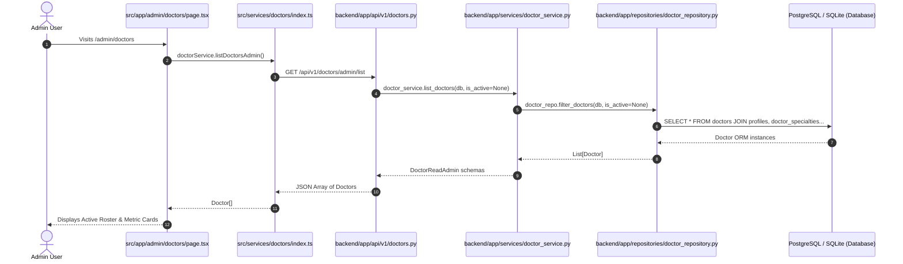
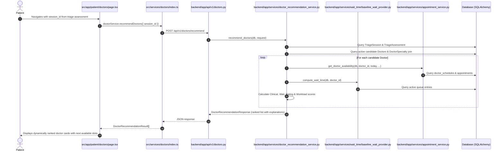
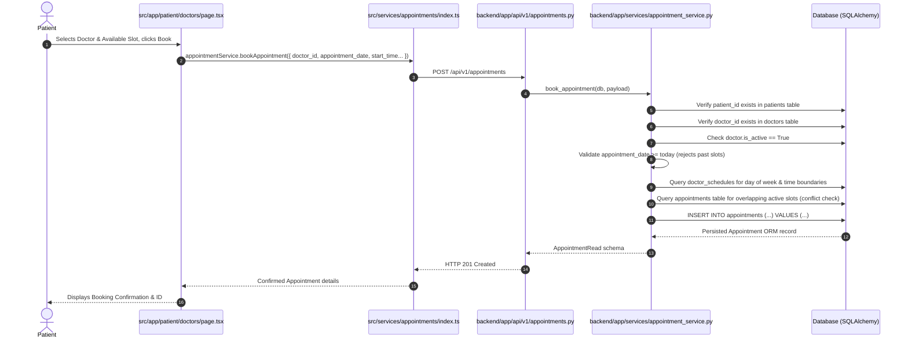

# CareRoute-X Doctor Data Flow Audit Report

**Date:** October 22, 2026  
**Auditor:** Antigravity Agentic Pair Programmer  
**Project Root:** `D:\medcon5`  
**Scope:** Doctor Directory, Patient Doctor Recommendations, Doctor Portal, Demo/Seed Data, and Appointment Booking  
**Audit Type:** Strict Read-Only Architecture & Data Trace Audit  

---

## Executive Summary

This audit evaluates whether the doctor section in CareRoute-X is genuinely database-driven or relies on hardcoded/mock doctor data.

### Overall Verdict: **PARTIALLY DATABASE-DRIVEN**

* **Core Operational & Transactional Engines (100% DATABASE-DRIVEN):**
  * The **Admin Physician Directory** fetches live records from the database via FastAPI endpoints backed by SQLAlchemy queries on the `doctors`, `profiles`, `doctor_specialties`, `departments`, and `hospitals` tables.
  * The **Patient Doctor Recommendation Engine** computes scores and rankings dynamically from database records (candidate doctors, specialties, schedules, and live queue wait-time baseline calculations).
  * The **Appointment Booking Workflow** validates candidate doctors, slots, schedule windows, and conflict checks directly against the database (`doctor_schedules` and `appointments` tables) and persists bookings to PostgreSQL/SQLite.
  * The **Doctor Live Queue & Operational Workflow** fetches patient queues, calls patients, transitions consultation states, and marks no-shows directly through database-backed endpoints.
* **Seed & Authentication Fixtures (SEEDED DATABASE DATA):**
  * The default accounts (`pat_101`, `doc_202`, `adm_303`) are populated directly into database tables (`profiles`, `patients`, `doctors`) via `backend/app/db/seed_dev.py`. The frontend authenticates against these seeded database records using signed JSON Web Tokens.
* **Presentation-Layer Hardcoded Relics (HARDCODED / MOCK):**
  * The dedicated **Doctor Profile page** (`src/app/doctor/profile/page.tsx`) and the **Doctor Portal sidebar badge** (`src/app/doctor/layout.tsx`) use static JSX text (`"Dr. Anita Menon, MD"`, `"Room 204 · Adult OPD"`), rather than loading the profile dynamically via `GET /api/v1/doctors/me`.
  * The **Doctor Dashboard greeting header** (`src/app/doctor/dashboard/page.tsx`) displays static text (`"Good morning, Dr. Menon."`, `"18 appointments"`), even though the queue and active consultation cards below it are genuinely database-driven.
  * An obsolete static mock array `DOCTORS_DATABASE` exists in `src/services/doctors/index.ts`, but it is dead code and is not referenced by any active component.

---

## 1. Flow 1: Doctor Directory (Admin Physicians Page)

### 1.1 Architectural Trace



### 1.2 Evidence & Code References

1. **Frontend Page Call:**
   * **File:** [`src/app/admin/doctors/page.tsx`](file:///D:/medcon5/src/app/admin/doctors/page.tsx#L31-L49)
   * **Lines 31–49:** `fetchDoctors` calls `doctorService.listDoctorsAdmin()`.
2. **Frontend Service Method:**
   * **File:** [`src/services/doctors/index.ts`](file:///D:/medcon5/src/services/doctors/index.ts#L339-L348)
   * **Lines 339–348:**
     ```typescript
     async listDoctorsAdmin(): Promise<Doctor[]> {
       const response = await apiClient.get<DoctorListResponse>('/api/v1/doctors/admin/list');
       return response.data.map((item) => this.mapApiDoctor(item));
     }
     ```
3. **Backend API Endpoint:**
   * **File:** [`backend/app/api/v1/doctors.py`](file:///D:/medcon5/backend/app/api/v1/doctors.py#L50-L72)
   * **Lines 50–72:** Endpoint `@router.get("/admin/list", response_model=DoctorListResponse)` enforced with `current_user: Profile = Depends(require_admin)`. Calls `doctor_service.list_doctors(db, is_active=None)`.
4. **Backend Service & Repository Query:**
   * **File:** [`backend/app/services/doctor_service.py`](file:///D:/medcon5/backend/app/services/doctor_service.py#L35-L51)
   * **File:** [`backend/app/repositories/doctor_repository.py`](file:///D:/medcon5/backend/app/repositories/doctor_repository.py#L42-L74)
   * **Lines 42–74:**
     ```python
     def filter_doctors(self, db: Session, hospital_id: Optional[str] = None, ...):
         query = (
             db.query(Doctor)
             .options(
                 joinedload(Doctor.profile),
                 joinedload(Doctor.specialties).joinedload(DoctorSpecialty.specialty),
                 joinedload(Doctor.department),
                 joinedload(Doctor.hospital),
             )
         )
         if is_active is not None:
             query = query.filter(Doctor.is_active == is_active)
         return query.all()
     ```
5. **Investigation of Frontend Mocks:**
   * **File:** [`src/services/doctors/index.ts`](file:///D:/medcon5/src/services/doctors/index.ts#L204-L250) contains a static array `DOCTORS_DATABASE` with 6 hardcoded doctors (`doc_01` to `doc_06`) and helper methods `getAllDoctors()`, `getDoctorById()`, `getExplainableMatches()`.
   * **Grep Verification:** Neither `getAllDoctors` nor `getExplainableMatches` nor `DOCTORS_DATABASE` is imported or invoked by `src/app/admin/doctors/page.tsx` or any active UI route. It is unreferenced legacy dead code.

### 1.3 Flow 1 Classification: **DATABASE-DRIVEN**
The Admin Physician directory strictly retrieves and renders database records via authenticated REST APIs and SQLAlchemy joins.

---

## 2. Flow 2: Patient Doctor Recommendations

### 2.1 Architectural Trace



### 2.2 Evidence & Code References

1. **Frontend Trigger & Query Params:**
   * **File:** [`src/app/patient/doctors/page.tsx`](file:///D:/medcon5/src/app/patient/doctors/page.tsx#L40-L75)
   * **Lines 40–75:** Reads `session_id` and `urgency` from URL search params. Invokes `doctorService.recommendDoctors({ session_id, preferred_mode, max_results: 6 })`.
2. **Frontend Service Endpoint:**
   * **File:** [`src/services/doctors/index.ts`](file:///D:/medcon5/src/services/doctors/index.ts#L309-L337)
   * **Lines 309–337:** Issues `POST /api/v1/doctors/recommend`.
3. **Backend Route Handler:**
   * **File:** [`backend/app/api/v1/doctors.py`](file:///D:/medcon5/backend/app/api/v1/doctors.py#L27-L47)
   * **Lines 27–47:** Endpoint `@router.post("/recommend", response_model=DoctorRecommendationResponse)`. Injects `db: Session = Depends(get_db)` and delegates to `doctor_recommendation_service.recommend_doctors(db, request)`.
4. **Recommendation Engine Database Execution:**
   * **File:** [`backend/app/services/doctor_recommendation_service.py`](file:///D:/medcon5/backend/app/services/doctor_recommendation_service.py#L43-L255)
   * **Lines 50–74:** Queries `TriageSession` and `TriageAssessment` from database to extract clinical urgency, red flag screening status, and `target_specialty_id`.
   * **Lines 76–84:** Fetches all active doctors using `doctor_repo.filter_doctors(db, hospital_id=..., is_active=True)`.
   * **Lines 101–142:** Iterates through candidate doctors and queries live schedule/slot data from `appointment_service.get_doctor_availability(db, doctor.id, ...)`.
   * **Lines 135–139:** Queries live queue volume and wait times via `baseline_wait_provider.py` querying `queue_repo.get_active_queue_for_doctor(db, ...)`.
   * **Lines 144–216:** Computes multi-factor explainable recommendation score:
     $$\text{Total Score} = w_{\text{spec}} \cdot S_{\text{spec}} + w_{\text{urg}} \cdot S_{\text{urg}} + w_{\text{avail}} \cdot S_{\text{avail}} + w_{\text{load}} \cdot S_{\text{load}} + w_{\text{exp}} \cdot S_{\text{exp}} + w_{\text{rat}} \cdot S_{\text{rat}}$$
   * **Doctor Attributes Origin:**
     * **Doctor Name:** Populated from `Doctor.profile.full_name` in database.
     * **Specialty:** Populated from `Doctor.specialties[i].specialty.name` in database.
     * **Ratings:** `Doctor.average_rating` and `Doctor.rating_count` in database.
     * **Experience:** `Doctor.years_of_experience` in database.
     * **Languages:** `Doctor.languages` (JSON column in database).
     * **Consultation Mode:** `Doctor.consultation_mode` in database.
     * **Availability Slots:** Dynamically derived from `doctor_schedules` minus booked `appointments` in database.
     * **Consultation Fee:** Neither `Doctor` nor `DoctorSpecialty` defines a consultation fee attribute. No fee is displayed or fabricated.

### 2.3 Flow 2 Classification: **DATABASE-DRIVEN**
Patient recommendations are computed dynamically in Python via SQLAlchemy queries across multiple relational models. No doctor cards, rankings, or ratings are mocked or hardcoded on the frontend.

---

## 3. Flow 3: Doctor Portal

### 3.1 Operational Queue & Active Consultation (`/doctor/queue` & `/doctor/dashboard`)

* **Queue Data Source:**
  * **File:** [`src/app/doctor/queue/page.tsx`](file:///D:/medcon5/src/app/doctor/queue/page.tsx#L32-L47)
  * Calls `queueService.getDoctorQueue("me")` -> `GET /api/v1/queues/me/current`.
  * **Backend Route:** [`backend/app/api/v1/queues.py`](file:///D:/medcon5/backend/app/api/v1/queues.py#L111-L128).
  * Calls `_get_authenticated_doctor(db, current_user)` to look up the doctor record for the logged-in JWT profile, then queries `queue_repo.get_active_queue_for_doctor(db, doctor.id)`.
  * **Queue Actions:**
    * Calling a patient calls `POST /api/v1/queues/{entry_id}/call`.
    * Starting a consult calls `POST /api/v1/queues/{entry_id}/start`.
    * Marking a no-show calls `POST /api/v1/queues/{entry_id}/no-show`.
    * Completing a consult calls `POST /api/v1/queues/{entry_id}/complete`.
  * All state transitions are saved in the `queue_entries` and `consultations` database tables.
  * **Classification:** **DATABASE-DRIVEN**.

### 3.2 Doctor Appointments Roster (`/doctor/appointments`)

* **Appointments Source:**
  * **File:** [`src/app/doctor/appointments/page.tsx`](file:///D:/medcon5/src/app/doctor/appointments/page.tsx#L40-L54)
  * Calls `appointmentService.getAllAppointments()` -> `GET /api/v1/appointments`.
  * **Backend Route:** [`backend/app/api/v1/appointments.py`](file:///D:/medcon5/backend/app/api/v1/appointments.py#L101-L115).
  * Backend detects the caller has role `DOCTOR`, retrieves their doctor record from `doctors` table, filters appointments where `Appointment.doctor_id == doctor.id`, and joins patient profiles.
  * **Classification:** **DATABASE-DRIVEN**.

### 3.3 Hardcoded Relics in Doctor Portal UI

While the operational data is database-driven, three static UI areas do not bind to backend data:

1. **Doctor Profile Page:**
   * **File:** [`src/app/doctor/profile/page.tsx`](file:///D:/medcon5/src/app/doctor/profile/page.tsx#L12-L98)
   * The page does not call `doctorService.getCurrentDoctor()` or any API.
   * All displayed credentials are hardcoded JSX strings:
     * `"Dr. Anita Menon, MD"`
     * `"Senior Consultant · Internal Medicine & Pulmonology"`
     * `"Station Room 204"`
     * `"License: MC-2014-9982"`
     * `"Education: MBBS, MD - Internal Medicine, Johns Hopkins School of Medicine"`
   * The availability toggle (`checked={available}`) only modifies local React state (`useState(true)`).
   * **Classification:** **HARDCODED**.
2. **Doctor Layout Sidebar Badge:**
   * **File:** [`src/app/doctor/layout.tsx`](file:///D:/medcon5/src/app/doctor/layout.tsx#L62-L82)
   * Contains static HTML:
     ```tsx
     <p className="text-xs font-semibold text-slate-800 truncate">Dr. Anita Menon, MD</p>
     <p className="text-[11px] text-slate-400 truncate">Room 204 · Adult OPD</p>
     ```
   * **Classification:** **HARDCODED**.
3. **Doctor Dashboard Static Header:**
   * **File:** [`src/app/doctor/dashboard/page.tsx`](file:///D:/medcon5/src/app/doctor/dashboard/page.tsx#L103-L109)
   * Contains static strings:
     ```tsx
     <span className="text-xs font-medium text-slate-400">Room 204 · Adult Outpatient Clinic</span>
     <h1 className="text-xl font-bold text-slate-900 tracking-tight mt-0.5">Good morning, Dr. Menon.</h1>
     <p className="text-xs text-slate-500 mt-1">18 appointments scheduled · Queue operational</p>
     ```
   * (Note: The cards below this banner—such as "Active Patient Consultation" and "Live Patient Queue"—are genuinely fetched from database APIs).
   * **Classification:** **HARDCODED (Header Banner) / MIXED (Page overall)**.

### 3.4 Flow 3 Classification: **MIXED**
Queue entries, appointments, consultation sessions, and patient states are 100% database-driven. The doctor profile view, portal sidebar badge, and dashboard welcome banner contain hardcoded presentation strings.

---

## 4. Flow 4: Demo Accounts and Seed Data

### 4.1 Database Seeding (`backend/app/db/seed_dev.py`)

* **File:** [`backend/app/db/seed_dev.py`](file:///D:/medcon5/backend/app/db/seed_dev.py#L32-L175)
* **Lines 32–75:** Seeds core entities:
  * Hospital: `"hosp_general"` ("Metro Health General Hospital")
  * Departments: `"dept_im"` ("Internal Medicine"), `"dept_derm"` ("Dermatology"), etc.
  * Specialties: `"spec_gen_med"` ("General Medicine"), `"spec_cardio"` ("Cardiology"), `"spec_derm"` ("Dermatology"), etc.
* **Lines 77–148:** Seeds three test accounts:
  1. **Patient:** Profile ID `pat_101` (`"Sarah Jenkins"`, role `PATIENT`) inserted into `profiles` and `patients`.
  2. **Doctor:** Profile ID `doc_202` (`"Dr. Anita Menon, MD"`, role `DOCTOR`) inserted into `profiles` and `doctors`. Associated with specialty `"spec_gen_med"`, department `"dept_im"`, 12 years of experience, rating 4.8.
  3. **Admin:** Profile ID `adm_303` (`"Mark Evans"`, role `ADMIN`) inserted into `profiles`.
* **Lines 150–175:** Seeds a weekly recurring Monday–Friday 09:00–17:00 schedule for `doc_202` in `doctor_schedules`.
* **Persistence:** All records are inserted with `db.add(...)` and saved with `db.commit()`. They exist permanently in the SQLite/PostgreSQL database.

### 4.2 Frontend Mock vs. Database Synchronization

* **File:** [`src/services/auth/index.ts`](file:///D:/medcon5/src/services/auth/index.ts#L48-L95)
* Lines 48–78 define `MOCK_USERS` for quick role-switching in the UI:
  * `"patient"` -> Profile `pat_101`
  * `"doctor"` -> Profile `doc_202`
  * `"admin"` -> Profile `adm_303`
* Lines 80–95 generate or assign pre-signed HS256 JWT tokens containing `{"sub": user.id, "role": user.role}`:
  * When a user selects a role, the token is written to `localStorage.setItem('careroute_auth_token', token)`.
  * Every Axios request sent to FastAPI includes `Authorization: Bearer <token>`.
  * FastAPI validates the JWT signature, decodes `sub` (e.g. `doc_202`), and queries the database for `Profile` and `Doctor`.

### 4.3 Flow 4 Classification: **SEEDED DATABASE DATA**
The demo accounts are not client-side mock fixtures. They are genuine, relational database rows populated by `seed_dev.py` and referenced directly through signed JWTs.

---

## 5. Flow 5: Appointment Booking

### 5.1 Architectural Trace



### 5.2 Evidence & Code References

1. **Frontend Booking Trigger:**
   * **File:** [`src/app/patient/doctors/page.tsx`](file:///D:/medcon5/src/app/patient/doctors/page.tsx#L106-L135)
   * **Lines 106–135:** `handleConfirmBooking` dispatches:
     ```typescript
     await appointmentService.bookAppointment({
       doctor_id: selectedDoctor.id,
       appointment_date: selectedSlot.date,
       start_time: selectedSlot.time,
       end_time: calculateEndTime(selectedSlot.time, 30),
       type: 'IN_PERSON',
       session_id: sessionId || undefined,
     });
     ```
2. **Frontend Service Endpoint:**
   * **File:** [`src/services/appointments/index.ts`](file:///D:/medcon5/src/services/appointments/index.ts#L137-L149)
   * **Lines 137–149:** Issues `POST /api/v1/appointments`.
3. **Backend Route Handler:**
   * **File:** [`backend/app/api/v1/appointments.py`](file:///D:/medcon5/backend/app/api/v1/appointments.py#L32-L46)
   * **Lines 32–46:** Endpoint `@router.post("", response_model=AppointmentRead, status_code=201)` delegates to `appointment_service.book_appointment(db, payload)`.
4. **Backend Database Validation Logic:**
   * **File:** [`backend/app/services/appointment_service.py`](file:///D:/medcon5/backend/app/services/appointment_service.py#L110-L191)
   * **Lines 114–120:** Checks patient existence:
     ```python
     patient = db.query(Patient).filter(Patient.id == payload.patient_id).first()
     if not patient:
         raise AppError("Patient not found", code="PATIENT_NOT_FOUND", status_code=404)
     ```
   * **Lines 122–128:** Checks doctor existence and active status:
     ```python
     doctor = doctor_repo.get_doctor_by_id(db, payload.doctor_id)
     if not doctor or not doctor.is_active:
         raise AppError("Doctor not found or inactive", code="DOCTOR_NOT_FOUND", status_code=404)
     ```
   * **Lines 134–140:** Validates that slot is not in the past (`PAST_APPOINTMENT_NOT_ALLOWED`).
   * **Lines 142–159:** Queries `doctor_schedules` to ensure requested slot falls within the doctor's active working hours.
   * **Lines 161–178:** Performs conflict query on `appointments` table:
     ```python
     conflict = (
         db.query(Appointment)
         .filter(
             Appointment.doctor_id == payload.doctor_id,
             Appointment.appointment_date == payload.appointment_date,
             Appointment.status.notin_([AppointmentStatus.CANCELLED, AppointmentStatus.NO_SHOW]),
             Appointment.start_time < payload.end_time,
             Appointment.end_time > payload.start_time,
         )
         .first()
     )
     if conflict:
         raise AppError("Time slot is no longer available", code="SLOT_CONFLICT", status_code=409)
     ```
   * **Lines 180–190:** Inserts and commits the new appointment into the database.

### 5.3 Flow 5 Classification: **DATABASE-DRIVEN**
Appointment slot generation, doctor ID validation, schedule boundary checks, conflict resolution, and persistence are 100% database-driven.

---

## 6. What Happens When a New Doctor is Added to the Database?

If an administrator or backend script adds a new doctor via `POST /api/v1/doctors` (or directly via SQLAlchemy into the `profiles`, `doctors`, `doctor_specialties`, and `doctor_schedules` tables):

1. **Admin Physicians Page (`/admin/doctors`):**
   * **Result:** **Immediately visible.**
   * The page triggers `GET /api/v1/doctors/admin/list`, which queries `Doctor` with joined profiles. The new physician appears in the table with their real name, department, status, and active toggle.
2. **Patient Doctor Recommendations (`/patient/doctors`):**
   * **Result:** **Immediately recommended when specialty matches.**
   * When a patient completes a triage session recommending the new doctor's specialty, `recommend_doctors` queries the `doctors` table, scores the new doctor based on experience, rating, schedule, and live queue, and includes them in the ranked recommendation cards.
3. **Appointment Booking:**
   * **Result:** **Immediately bookable.**
   * The new doctor's available slots are derived from their `doctor_schedules`. Patients can select a slot and book an appointment. The backend validates the new doctor ID and saves the appointment to the database.
4. **Doctor Portal (`/doctor/queue` and `/doctor/appointments`):**
   * **Result:** **Fully functional queue and appointment list.**
   * If a JWT is issued with the new doctor's `profile_id`, the backend recognizes the new doctor, loads their real appointments, and manages their patient queue.
5. **Doctor Profile Page (`/doctor/profile`) and Layout Sidebar:**
   * **Result:** **Shows Dr. Anita Menon (Stale Hardcoded UI).**
   * The new doctor will see their own operational queue, but the dedicated profile page (`/doctor/profile`), the top dashboard banner, and the sidebar badge will still display `"Dr. Anita Menon, MD"` and `"Room 204"` because those components contain static JSX strings rather than dynamic profile bindings.

---

## 7. Comprehensive Evidence and Classification Matrix

| Feature / Flow | File Path | Line Range | Endpoint / Query | Classification | Status & Notes |
| :--- | :--- | :--- | :--- | :--- | :--- |
| **Admin Doctor Directory** | [`src/app/admin/doctors/page.tsx`](file:///D:/medcon5/src/app/admin/doctors/page.tsx) | 31–49 | `GET /api/v1/doctors/admin/list` | **DATABASE-DRIVEN** | Queries `doctors` table with `joinedload(Doctor.profile, Doctor.specialties)`. |
| **Admin Doctor List API** | [`backend/app/api/v1/doctors.py`](file:///D:/medcon5/backend/app/api/v1/doctors.py) | 50–72 | `doctor_service.list_doctors()` | **DATABASE-DRIVEN** | Authenticated via `require_admin`. |
| **Admin Doctor Repository** | [`backend/app/repositories/doctor_repository.py`](file:///D:/medcon5/backend/app/repositories/doctor_repository.py) | 42–74 | `db.query(Doctor).options(...)` | **DATABASE-DRIVEN** | Directly queries SQLAlchemy ORM. |
| **Unused Mock Constant** | [`src/services/doctors/index.ts`](file:///D:/medcon5/src/services/doctors/index.ts) | 204–250 | None (In-memory array) | **MOCK/FIXTURE** | Dead code. Not imported or called by active pages. |
| **Patient Recommendation UI** | [`src/app/patient/doctors/page.tsx`](file:///D:/medcon5/src/app/patient/doctors/page.tsx) | 40–75 | `POST /api/v1/doctors/recommend` | **DATABASE-DRIVEN** | Forwards triage session ID to recommendation API. |
| **Recommendation Engine** | [`backend/app/services/doctor_recommendation_service.py`](file:///D:/medcon5/backend/app/services/doctor_recommendation_service.py) | 43–255 | SQLAlchemy filter on `Doctor` & `DoctorSpecialty` | **DATABASE-DRIVEN** | Dynamic scoring based on clinical match, wait times, rating, and load. |
| **Doctor Availability Calculation** | [`backend/app/services/appointment_service.py`](file:///D:/medcon5/backend/app/services/appointment_service.py) | 38–108 | Queries `doctor_schedules` & `appointments` | **DATABASE-DRIVEN** | Generates slots on-the-fly minus booked appointments. |
| **Appointment Booking Validation** | [`backend/app/services/appointment_service.py`](file:///D:/medcon5/backend/app/services/appointment_service.py) | 110–191 | Queries `patients`, `doctors`, `doctor_schedules`, `appointments` | **DATABASE-DRIVEN** | Checks existence, active status, past times, schedule bounds, and slot collisions. |
| **Doctor Queue UI & Actions** | [`src/app/doctor/queue/page.tsx`](file:///D:/medcon5/src/app/doctor/queue/page.tsx) | 32–120 | `GET /api/v1/queues/me/current`, `POST /call`, `/start`, `/complete` | **DATABASE-DRIVEN** | State transitions update `queue_entries` and `consultations`. |
| **Doctor Appointments UI** | [`src/app/doctor/appointments/page.tsx`](file:///D:/medcon5/src/app/doctor/appointments/page.tsx) | 40–54 | `GET /api/v1/appointments` | **DATABASE-DRIVEN** | Backend filters appointments where `doctor_id == current_user.doctor.id`. |
| **Doctor Portal Sidebar Badge** | [`src/app/doctor/layout.tsx`](file:///D:/medcon5/src/app/doctor/layout.tsx) | 62–82 | None (Hardcoded JSX) | **HARDCODED** | Hardcoded text: `"Dr. Anita Menon, MD"` & `"Room 204 · Adult OPD"`. |
| **Doctor Dashboard Header** | [`src/app/doctor/dashboard/page.tsx`](file:///D:/medcon5/src/app/doctor/dashboard/page.tsx) | 103–109 | None (Hardcoded JSX) | **HARDCODED** | Static text: `"Good morning, Dr. Menon."` & `"18 appointments"`. |
| **Doctor Profile Page** | [`src/app/doctor/profile/page.tsx`](file:///D:/medcon5/src/app/doctor/profile/page.tsx) | 12–98 | None (Hardcoded JSX) | **HARDCODED** | Hardcoded text: `"Dr. Anita Menon, MD"`, `"Johns Hopkins"`, etc. |
| **Development Seed Data** | [`backend/app/db/seed_dev.py`](file:///D:/medcon5/backend/app/db/seed_dev.py) | 77–148 | `db.add(Doctor(...))`, `db.commit()` | **SEEDED DATABASE DATA** | Persists `doc_202`, `pat_101`, and `adm_303` to SQLite/PostgreSQL. |
| **Demo Auth Switching** | [`src/services/auth/index.ts`](file:///D:/medcon5/src/services/auth/index.ts) | 48–95 | Signed JWTs matching seed IDs | **SEEDED DATABASE DATA** | JWT `sub` maps to database profiles `doc_202`, `pat_101`, `adm_303`. |

---

## 8. Final Verdict and Justification

### Final Verdict: **PARTIALLY DATABASE-DRIVEN**

### Justification Summary

1. **Why it is not "Mostly hardcoded/mock":**
   All critical data paths—including the Admin Physicians directory, patient doctor matching, triage-to-specialty recommendation scoring, slot generation, appointment booking conflict resolution, and the live doctor caller queue—are genuinely wired to FastAPI and SQLAlchemy. Adding or updating records in the database directly alters what patients, admins, and doctors see in their operational workflows.
2. **Why it is not "Fully database-driven":**
   The doctor portal contains several unlinked presentation fixtures. Specifically, the Doctor Profile page (`src/app/doctor/profile/page.tsx`), the doctor layout sidebar badge (`src/app/doctor/layout.tsx`), and the doctor dashboard greeting banner (`src/app/doctor/dashboard/page.tsx`) display static hardcoded strings for `"Dr. Anita Menon, MD"` and `"Room 204"` instead of fetching the profile of the authenticated doctor via `GET /api/v1/doctors/me`.
3. **Conclusion:**
   CareRoute-X possesses a real, functioning relational database backend for its clinical and scheduling flows, complemented by seeded demo accounts, alongside lingering static presentation elements in the Doctor Portal UI.
