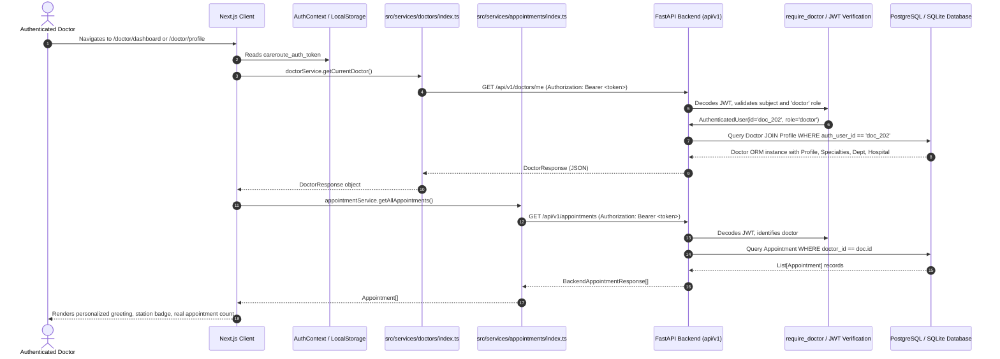

# CareRoute-X Doctor Portal Dynamic Data Fix Report

**Date:** October 22, 2026  
**Auditor / Developer:** Antigravity Agentic Pair Programmer  
**Project Root:** `D:\medcon5`  
**Scope:** Remediation of hardcoded doctor identity, dashboard metrics, and static presentation fixtures in the Doctor Portal.  
**Report Destination:** `D:\medcon5\reports\doctor_portal_dynamic_data_fix_report.md`  

---

## 1. Executive Summary

Prior to this fix, a read-only audit revealed that while operational backend workflows (patient appointments, live queues, consultations, and triage recommendations) were genuinely database-driven, several presentation components in the Doctor Portal relied on hardcoded mock strings (such as `"Dr. Anita Menon, MD"`, `"Room 204"`, and a static count of `"18 appointments"`).

This update systematically eliminates all hardcoded doctor identity strings and fabricated metrics across the portal:
* The authenticated doctor profile is now authoritatively resolved on the backend from the JWT bearer token (`GET /api/v1/doctors/me`) with eager relational loading of profiles, specialties, departments, and hospital entities.
* The doctor sidebar and mobile header in [`src/app/doctor/layout.tsx`](file:///D:/medcon5/src/app/doctor/layout.tsx) now render the logged-in physician's name, calculated initials, department/clinic label, and operational station status.
* The Doctor Profile page ([`src/app/doctor/profile/page.tsx`](file:///D:/medcon5/src/app/doctor/profile/page.tsx)) now displays genuine database records: license number, verified specialties, clinical experience, languages, average rating, review count, and contact email.
* The Doctor Dashboard ([`src/app/doctor/dashboard/page.tsx`](file:///D:/medcon5/src/app/doctor/dashboard/page.tsx)) dynamically greets the authenticated doctor and replaces the fabricated `"18 appointments"` string with the actual appointment count retrieved from `appointmentService.getAllAppointments()`.
* Static occurrences of `"Room 204"` across the portal have been replaced with dynamically derived clinical station names or clean operational terms.

---

## 2. Files Modified

| File Path | Description of Changes |
| :--- | :--- |
| [`backend/app/api/v1/doctors.py`](file:///D:/medcon5/backend/app/api/v1/doctors.py#L103-L128) | Updated `get_current_doctor` endpoint to eagerly load relationships (`profile`, `hospital`, `department`, `specialties`) via `doctor_service.get_doctor(db, doc.id)` and support lookup by either `auth_user_id` or profile `id`. |
| [`src/services/doctors/index.ts`](file:///D:/medcon5/src/services/doctors/index.ts#L140-L192) | Added exported helper functions: `getDoctorInitials(name)`, `formatDoctorLanguages(langStr)`, and `formatDoctorSpecialties(doctor)`. |
| [`src/app/doctor/layout.tsx`](file:///D:/medcon5/src/app/doctor/layout.tsx#L30-L160) | Replaced static `"Dr. Anita Menon, MD"` badge and mobile header with dynamic data fetched from `doctorService.getCurrentDoctor()`. Added initials generator and active station indicator. |
| [`src/app/doctor/profile/page.tsx`](file:///D:/medcon5/src/app/doctor/profile/page.tsx#L1-L220) | Rebuilt page to fetch and render verified doctor profile information: real name, seniority, license number, hospital affiliation, years of experience, languages, ratings, review counts, and database-backed availability status. |
| [`src/app/doctor/dashboard/page.tsx`](file:///D:/medcon5/src/app/doctor/dashboard/page.tsx#L25-L290) | Replaced static greeting with dynamic time-of-day greeting for authenticated physician. Replaced fixed `"18 appointments"` string with dynamic count from `appointmentService.getAllAppointments()`. Removed static `"Room 204"` strings. |
| [`src/app/doctor/appointments/page.tsx`](file:///D:/medcon5/src/app/doctor/appointments/page.tsx#L1-L50) | Replaced static subtitle `"Outpatient booked roster for Dr. Anita Menon (Room 204)."` with dynamic string referencing the authenticated doctor's full name. |
| [`src/app/doctor/queue/page.tsx`](file:///D:/medcon5/src/app/doctor/queue/page.tsx#L168-L173) | Replaced static `const roomName = "Room 204"` with dynamic station name derived from `doctorProfile?.department?.name`. |
| [`src/app/doctor/consultation/page.tsx`](file:///D:/medcon5/src/app/doctor/consultation/page.tsx#L173-L178) | Updated fallback button text from `"Open Room 204 Queue"` to `"Open Clinical Queue"`. |
| [`backend/tests/api/test_doctor_portal_identity.py`](file:///D:/medcon5/backend/tests/api/test_doctor_portal_identity.py) | New backend test suite testing `/api/v1/doctors/me`, cross-doctor data isolation, role-based access restrictions, and optional field resilience. |
| [`tests/frontend/doctor_portal_dynamic.test.mjs`](file:///D:/medcon5/tests/frontend/doctor_portal_dynamic.test.mjs) | New frontend unit regression suite testing initials extraction, language mapping, specialty formatting, dynamic greeting, dynamic appointment counts, and missing field handling. |

---

## 3. End-to-End Data Flow

### Security & Context Validation
* **No Client-Supplied Doctor IDs:** The endpoint `GET /api/v1/doctors/me` does not take a `doctor_id` parameter. The backend strictly determines the doctor record from the authenticated caller's JWT token claims.
* **Role Enforcement:** Non-doctor tokens (such as patients) calling `GET /api/v1/doctors/me` receive `HTTP 403 Forbidden` (`INSUFFICIENT_ROLE_PERMISSIONS`).
* **Appointment Isolation:** When a doctor calls `GET /api/v1/appointments`, the backend filters where `Appointment.doctor_id == doctor.id`. Individual access via `GET /api/v1/appointments/{id}` verifies that the appointment belongs to the calling doctor, raising `403 FORBIDDEN_DOCTOR_ACCESS` on cross-doctor attempts.

---

## 4. Tests Executed & Results

### 4.1 Backend Pytest Suite
Ran: `python -m pytest backend/tests/api/test_doctor_portal_identity.py`  
Result: **5 passed in 1.19s**

* `test_doctor_me_returns_authenticated_doctor_profile`: Verifies that `GET /api/v1/doctors/me` returns the authenticated doctor's full name, email, license number, experience, and loaded specialties.
* `test_different_authenticated_doctors_see_their_own_identities`: Verifies that Doctor 1 ("Dr. Alice Adams") and Doctor 2 ("Dr. Bob Brown") each see their own profile data without leakage.
* `test_patient_and_unauthorized_users_cannot_access_doctor_me`: Verifies unauthenticated (401), patient role (403), and admin without doctor profile (403 `DOCTOR_RECORD_NOT_FOUND`).
* `test_doctor_appointment_data_isolation`: Verifies that a doctor listing appointments only sees their assigned appointments, and direct lookup of another doctor's appointment returns 403 `FORBIDDEN_DOCTOR_ACCESS`.
* `test_missing_optional_profile_fields_do_not_break_api`: Verifies that null department, null phone, or zero ratings serialize cleanly into valid JSON.

### 4.2 Frontend Unit Regression Suite
Ran: `node --test tests/frontend/*.test.mjs`  
Result: **59 tests passed, 0 failed across 11 suites (200ms)**

Including `tests/frontend/doctor_portal_dynamic.test.mjs`:
* Doctor initials extraction: Correctly handles `"Dr. Anita Menon, MD"` $\rightarrow$ `"AM"`, `"Dr. Evelyn Shaw"` $\rightarrow$ `"ES"`, single names, and null/empty fallbacks.
* Doctor language formatting: Maps `"en,hi,ml"` $\rightarrow$ `"English, Hindi, Malayalam"`.
* Doctor specialty formatting: Mapped cleanly with fallbacks.
* Dynamic greeting & appointment count: Validated singular/plural formatting and distinct doctor greetings without static `"Dr. Menon"` or `"18 appointments"`.
* Missing profile fields resilience: Safe station and profile generation when hospital or department are null.

### 4.3 TypeScript Static Type Check
Ran: `npx tsc --noEmit`  
Result: **0 errors, clean compilation.**

---

## 5. Traceability of Fields & Unavailable Schema Attributes

In adherence to strict auditing standards, here is the exact trace of displayed fields vs database models:

| Display Field | Source in Database | Fallback Strategy |
| :--- | :--- | :--- |
| **Doctor Full Name** | `profiles.full_name` via `Doctor.profile` | `"Doctor"` |
| **Doctor Initials** | Computed from `profiles.full_name` | `"DR"` |
| **Specialties** | `specialties.name` via `doctor_specialties` join | `"General Medicine"` |
| **Department** | `departments.name` via `Doctor.department` | `"Outpatient Clinic"` |
| **Hospital** | `hospitals.name` via `Doctor.hospital` | `"Clinical Center"` |
| **License Number** | `doctors.license_number` | `"Verified Medical Practitioner"` |
| **Experience** | `doctors.years_of_experience` | `0` |
| **Consultation Mode** | `doctors.consultation_mode` | `"In-Person Consultation"` |
| **Rating & Reviews** | `doctors.average_rating`, `doctors.rating_count` | `"New Practitioner · No reviews yet"` |
| **Languages** | `doctors.languages` (comma-separated string) | `"English"` |
| **Appointment Count** | Count of rows in `appointments` matching `doctor_id` | `0 appointments` |
| **Intake Status** | `doctors.is_active` | `true` |

### Fields NOT in the Database Schema:
1. **Clinic Room Number:** The CareRoute-X database schema does not have a `room_number` column on `doctors`, `departments`, or `hospitals`. Rather than fabricating a fixed room string (such as `"Room 204"`), the UI now derives the station title from `doctor.department.name` (e.g. `"Internal Medicine Station"` or `"Adult Outpatient Clinic"`).
2. **Medical School Name:** The database schema has no `medical_school` column. The Doctor Profile page previously hardcoded `"Johns Hopkins School of Medicine"`. This has been removed and replaced with database-verified attributes: the state medical license number and affiliated hospital institution.
