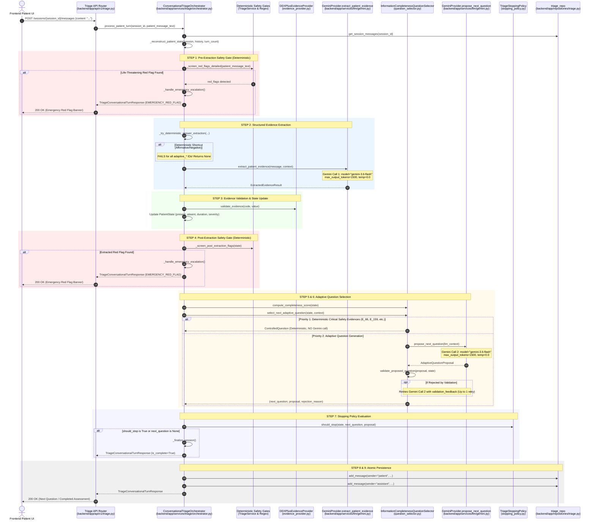

# CareRoute-X — Gemini Request Efficiency & Quota Audit Report

**Report Location:** `D:\medcon5\reports\gemini_request_efficiency_audit.md`  
**Date:** 2026-10-21  
**Audit Type:** Read-Only Architectural & Runtime Efficiency Audit  
**Target Subsystem:** Adaptive Conversational Triage Pipeline (`backend/app/services/triage`, `backend/app/services/llm`)  
**Context:** Investigation of HTTP 429 (`QUOTA_EXCEEDED`) and HTTP 503 (`SERVICE_UNAVAILABLE`) failures during multi-turn triage interactions.

---

## Executive Summary

During multi-turn conversational triage, a patient turn typically executes **two distinct Gemini API operations** sequentially:
1. `evidence_extraction` (`GeminiProvider.extract_patient_evidence`)
2. `question_proposal` (`GeminiProvider.propose_next_question`)

Under standard free-tier or burst-limited Gemini API quotas (e.g. 15 requests per minute, 1,500 requests per day), a typical 5-turn triage session consumes **10 to 12 Gemini API requests** (plus additional calls if question validation retries). If quota is exceeded, the pipeline attempts futile internal sleeps and retries, compounding latency, blocking backend worker threads, and triggering HTTP 503 failures on the frontend.

This audit confirmed three primary structural drivers of excessive API consumption:
1. **Deterministic extraction shortcut is 100% broken for all adaptive questions:** `_try_deterministic_answer_extraction` checks `evidence_provider.get_evidence(active_evidence_id)`. For adaptive questions, `active_evidence_id` is synthetic (e.g., `adaptive_duration_onset`), which is not in the DDXPlus dictionary. The shortcut unconditionally returns `None`, forcing Gemini calls even for single-word `"no"` or `"yes"` replies.
2. **Question proposal is invoked even when the stopping policy will immediately stop:** In `orchestrator.py`, `select_next_adaptive_question` (invoking Gemini) is called *before* `stopping_policy.should_stop`. When `conversation_turn >= max_turns` (turn 7) or when the patient explicitly declines further questions (`declined_to_continue = True`), Gemini generates a question that is immediately discarded.
3. **Flawed 429 retry handling causes futile sleeps and double-request bursts:** Standard Google GenAI 429 `RESOURCE_EXHAUSTED` errors that do not contain specific billing strings fail `_is_permanent_quota_error`, causing the backend to sleep 2–5 seconds and retry the exact same prompt against an already exhausted quota.

---

## 1. End-to-End Call Graph Trace

### Call Graph Overview



### Exact Code Points in Call Graph

1. **API Endpoint:**
   - File: [`backend/app/api/v1/triage.py:155-174`](file:///d:/medcon5/backend/app/api/v1/triage.py#L155-L174)
   - Function: `process_triage_message(session_id, message_in, db, current_user)`
   - Dispatches to `ConversationalTriageOrchestrator(db=db).process_patient_turn(...)`.

2. **Orchestrator Execution:**
   - File: [`backend/app/services/triage/orchestrator.py:110-341`](file:///d:/medcon5/backend/app/services/triage/orchestrator.py#L110-L341)
   - Function: `process_patient_turn(session_id, patient_message_text, actor_auth_user_id)`

3. **Gemini Operation 1 (Evidence Extraction):**
   - File: [`backend/app/services/llm/gemini.py:658-993`](file:///d:/medcon5/backend/app/services/llm/gemini.py#L658-L993)
   - Function: `GeminiProvider.extract_patient_evidence(message, context)`
   - Schema: `ExtractedEvidenceResult`

4. **Gemini Operation 2 (Adaptive Question Proposal):**
   - File: [`backend/app/services/llm/gemini.py:1292-1600`](file:///d:/medcon5/backend/app/services/llm/gemini.py#L1292-L1600)
   - Invoked via: [`backend/app/services/triage/question_selector.py:453-455`](file:///d:/medcon5/backend/app/services/triage/question_selector.py#L453-L455)
   - Function: `GeminiProvider.propose_next_question(context)`
   - Schema: `AdaptiveQuestionProposal`

---

## 2. Are Both Operations Required on Every Turn?

**Confirmed Finding:** **No.** Both operations are not required on every turn.

| Operational Scenario | Operation 1: Evidence Extraction Required? | Operation 2: Question Proposal Required? | Explanation |
| :--- | :--- | :--- | :--- |
| **Direct Yes/No reply to active question** | **No** (Should be deterministic) | Depends on gaps & completeness | When a patient answers "No" to "Are you having difficulty breathing?", deterministic extraction can record the absence without LLM intervention. |
| **Final Turn (`turn_count >= max_turns`)** | **Yes** (to capture final patient inputs) | **NO (100% Redundant)** | The stopping policy will unconditionally conclude the interview at `max_turns`. Generating a question on this turn is completely wasted. |
| **Patient explicitly declines (`"stop"`, `"skip"`)** | **Yes** (identifies `declined_to_continue`) | **NO (100% Redundant)** | The stopping policy unconditionally halts when `state.declined_to_continue` is true. Proposing a question here is wasted. |
| **Safety Priority Question Triggered** | **Yes** | **NO (Deterministic)** | Priority 1 in `question_selector.py:376-417` returns a controlled question for critical symptoms without calling Gemini. |
| **Pre-Extraction Red Flag Escalation** | **NO (Bypassed)** | **NO (Bypassed)** | If raw regex detects life-threatening keywords, the session immediately escalates without invoking either Gemini operation. |
| **Post-Extraction Red Flag Escalation** | **Yes** | **NO (Bypassed)** | If extracted evidence triggers `_screen_post_extraction_flags`, questioning terminates immediately before calling question selector. |

---

## 3. Deterministic Extraction Bug for Adaptive Questions

### Background & Intent
`_try_deterministic_answer_extraction` ([`orchestrator.py:400-494`](file:///d:/medcon5/backend/app/services/triage/orchestrator.py#L400-L494)) was designed to bypass Gemini when:
- An active question exists.
- The patient provides an unambiguous affirmative (`"yes"`, `"yeah"`, `"sure"`) or negative (`"no"`, `"nope"`, `"never"`).
- No new narrative symptoms, numbers, or connectors are present.

### Confirmed Flaw
In [`orchestrator.py:428-432`](file:///d:/medcon5/backend/app/services/triage/orchestrator.py#L428-L432):
```python
base_code = active_evidence_id.split("_@_")[0]
ev_meta = self.evidence_provider.get_evidence(active_evidence_id) or self.evidence_provider.get_evidence(base_code)
if not ev_meta:
    return None
```
In Phase 2, `select_next_adaptive_question` generates adaptive questions with synthetic IDs ([`question_selector.py:482`](file:///d:/medcon5/backend/app/services/triage/question_selector.py#L482)):
```python
evidence_id = f"adaptive_{target_slug}"  # e.g., "adaptive_duration_onset", "adaptive_functional_impact"
```
`DDXPlusEvidenceProvider` only indexes DDXPlus ontology codes (`E_0` to `E_250`). When queried with `adaptive_functional_impact`, `get_evidence()` returns `None`.

**Result:**  
Line 431 evaluates to `True` and returns `None` on **100% of adaptive questions**.  
Even if a patient replies with the exact single word `"No"` or `"Yes"`, the deterministic shortcut fails and triggers a full, expensive Gemini `extract_patient_evidence` call!

---

## 4. Question Generation Invocation When Stopping Policy Stops

### Confirmed Finding
In [`orchestrator.py:261-270`](file:///d:/medcon5/backend/app/services/triage/orchestrator.py#L261-L270):
```python
# Line 261: ALWAYS calls question selection (and thus Gemini propose_next_question)
next_question, proposal, rejection_reason = self.question_selector.select_next_adaptive_question(
    state=state, context=selector_context
)

# Line 266: ONLY THEN evaluates stopping policy
should_stop, stop_reason, needs_esc = self.stopping_policy.should_stop(
    state=state, next_question=next_question, proposal=proposal
)

if should_stop or next_question is None:
    return self._finalize_session(...)
```

In [`stopping_policy.py:126-152`](file:///d:/medcon5/backend/app/services/triage/stopping_policy.py#L126-L152):
- **Rule 2:** `if state.declined_to_continue:` -> Unconditionally returns `(True, "PATIENT_DECLINED", ...)`
- **Rule 6:** `if state.conversation_turn >= self.max_turns:` -> Unconditionally returns `(True, "INTERACTION_LIMIT_REACHED", ...)`

Because `select_next_adaptive_question` is called on line 261 before `should_stop` on line 266:
1. When the patient reaches turn 7 (`settings.TRIAGE_MAX_TURNS`), Gemini is invoked to generate a 7th question. That question is received, validated, passed to `should_stop`, and **immediately thrown away** as the session finalizes.
2. When the patient says `"I want to stop now, just show me a doctor"`, extraction identifies `declined_to_continue = True`. Gemini is then called to propose a question that is **immediately thrown away**.

---

## 5. Token Usage, Prompt Bloat, and Redundant Model Calls

### Token Breakdown per Turn

1. **`extract_patient_evidence`:**
   - **System Instruction:** ~750 characters (~190 tokens).
   - **Vocabulary Guide:** Hardcodes 35 symptom mapping pairs (`CONTROLLED_EVIDENCE_MAP`, [`gemini.py:672`](file:///d:/medcon5/backend/app/services/llm/gemini.py#L672)), adding ~250 tokens on every single turn, regardless of chief complaint.
   - **Context:** Active question, active evidence ID, initial complaint, patient message (~150 tokens).
   - **Response Schema:** Pydantic `ExtractedEvidenceResult` with nested lists and items.
   - **Configured `max_output_tokens`:** `1500` (actual output is typically 80–120 tokens).

2. **`propose_next_question`:**
   - **System Instruction:** ~1,200 characters (~300 tokens).
   - **Prompt Context:** Presenting complaint, latest message, duration, severity, functional impact, all known present, all known absent, all unknown findings, all questions asked, all information gaps, plus the last 6 conversation history turns ([`gemini.py:1356-1375`](file:///d:/medcon5/backend/app/services/llm/gemini.py#L1356-L1375)) (~400–600 tokens).
   - **Response Schema:** Pydantic `AdaptiveQuestionProposal`.
   - **Configured `max_output_tokens`:** `1500` (actual output is typically 90–140 tokens).

### Total Volume per Turn
- Input tokens per turn: **~1,200 – 1,500 tokens**.
- Output tokens reserved / budgeted: **3,000 tokens** (1500 + 1500).
- Across a 5-turn session: **~12,000 – 15,000 total tokens** across **10 separate HTTP requests**.
- On free-tier Gemini API (15 Requests Per Minute): A user typing answers in quick succession (e.g., 20–30 seconds per turn) reaches 10 requests within 90 seconds, triggering HTTP 429 quota exhaustion on turn 3.

---

## 6. Retry Handling: `SERVICE_UNAVAILABLE` vs. `QUOTA_EXCEEDED`

### Confirmed Flaw in Quota Error Classification and Backoff
In [`gemini.py:588-605`](file:///d:/medcon5/backend/app/services/llm/gemini.py#L588-L605):
```python
@staticmethod
def _is_permanent_quota_error(err_str: str) -> bool:
    s = err_str.lower()
    permanent_indicators = [
        "prepayment credits are depleted",
        "credits are depleted",
        "billing",
        "permanent quota",
        "quota exceeded for metric",
        "dailyrequestlimit",
        "perday",
    ]
    return any(ind in s for ind in permanent_indicators)
```

In [`gemini.py:901-957`](file:///d:/medcon5/backend/app/services/llm/gemini.py#L901-L957) and [`gemini.py:1536-1590`](file:///d:/medcon5/backend/app/services/llm/gemini.py#L1536-L1590):
```python
# FAIL FAST: permanent quota / billing exhaustion (do not retry)
if self._is_permanent_quota_error(err_str):
    ...
    raise TriageLLMUnavailableError(...)

is_transient_error = cat in (FAILURE_CATEGORY_SERVICE_UNAVAILABLE, FAILURE_CATEGORY_NETWORK_ERROR)

if (is_quota or is_transient_error) and attempt < 1:
    initial_failure_category = cat
    if is_quota:
        m = re.search(r"retry in (\d+(?:\.\d+)?)s", err_str, re.IGNORECASE)
        delay = min(int(float(m.group(1))) + 1, 5) if m else 2
        logger.warning(f"Gemini transient rate limit hit. Backing off for {delay}s...")
    else:
        delay = compute_gemini_backoff(diag, attempt)
    time.sleep(delay)
    continue
```

### Analysis of Failure Modes:
1. When Google GenAI raises `429 RESOURCE_EXHAUSTED` (e.g. `"Resource has been exhausted (e.g. check quota)"`, or `"Quota exceeded for quota group 'default'"`), `_is_permanent_quota_error` evaluates to `False`.
2. It enters the `if (is_quota or is_transient_error) and attempt < 1:` branch.
3. If the error message does not contain `"retry in Xs"`, `delay` defaults to `2` seconds. If it contains `"retry in 45s"`, `min(46, 5)` truncates the delay to `5` seconds!
4. The thread executes `time.sleep(2)` or `time.sleep(5)` and immediately issues `attempt=1` against an API that explicitly requested 45 seconds or has exhausted its daily/minute quota!
5. This second request is **guaranteed to fail with 429**, holding the synchronous FastAPI worker thread for 2–5 seconds, inflating latency, and doubling API request counts on an already rate-limited account.

In contrast, `SERVICE_UNAVAILABLE` (HTTP 503/502) handles transient capacity gracefully via exponential backoff and jitter (`compute_gemini_backoff`).

---

## 7. Interrupted Turn Persistence & Idempotency

### Confirmed Finding: Safe & Idempotent
We investigated whether a failed or retried turn could duplicate messages, evidence, or questions in the database.

1. **Backend Database Transactions:**
   - In [`orchestrator.py:286-317`](file:///d:/medcon5/backend/app/services/triage/orchestrator.py#L286-L317), `triage_repo.add_message` is invoked for both the patient and assistant messages **at the very end of `process_patient_turn`**, strictly after both extraction and question selection succeed.
   - If `GeminiProvider` throws `TriageLLMUnavailableError` at either step, the function aborts before calling `triage_repo.add_message`.
   - No partial database records are created in `triage_messages`.
   - `PatientState` is reconstructed dynamically from existing messages in the database on every turn ([`orchestrator.py:343-398`](file:///d:/medcon5/backend/app/services/triage/orchestrator.py#L343-L398)).
   - Therefore, a failed turn leaves **zero residue** in the database.

2. **Frontend Deduplication on Retry:**
   - In [`src/app/patient/triage/page.tsx:170-191`](file:///d:/medcon5/src/app/patient/triage/page.tsx#L170-L191):
     ```typescript
     setMessages((prev) => {
       const lastMsg = prev[prev.length - 1];
       if (lastMsg && lastMsg.sender === "patient" && lastMsg.content === textToSend) {
         return prev; // Deduplicated
       }
       return [...prev, { id: patientMsgId, sender: "patient", content: textToSend, ... }];
     });
     ```
   - When the user clicks the "Retry" button after an error, the frontend does not re-add the patient message to the UI.
   - Once the backend succeeds, the assistant message is appended normally.

---

## 8. Can Evidence Extraction and Question Proposal Safely Share a Model Call?

### Strict Analysis: They MUST Remain Separate

We analyzed whether combining evidence extraction and question proposal into a single Gemini prompt would be safe.

**Conclusion: Combining them is clinically and architecturally UNSAFE.**

### Safety & Architectural Rationale:

1. **Violation of the Deterministic Post-Extraction Safety Gate:**
   - The safety architecture mandates that extracted symptoms MUST pass through [`_screen_post_extraction_flags(state)`](file:///d:/medcon5/backend/app/services/triage/orchestrator.py#L234-L245) before any question is formulated.
   - If the patient enters: *"I have sudden crushing chest pain and feel dizzy"*, extraction extracts `E_54_@_V_180` and `E_82`.
   - Step 4 immediately triggers `_handle_emergency_escalation()` and halts questioning.
   - If combined, the model would be instructed to propose the next question *while simultaneously extracting*. Even if the question was discarded post-hoc, asking an LLM to generate a question on an emergency case risks hallucinating reassurance or conversational delay in the prompt output.

2. **Deterministic Priority 1 Safety Questions Would Be Bypassed:**
   - In [`question_selector.py:376-417`](file:///d:/medcon5/backend/app/services/triage/question_selector.py#L376-L417), the system checks whether critical safety evidences (`E_66` dyspnea, `E_159` syncope, `E_45` hemoptysis) need to be ruled out based on the complaint.
   - When triggered, it selects a vetted ontology question deterministically without calling Gemini.
   - Combining operations would force Gemini to generate a question even when a deterministic clinical safety question is mandatory.

3. **Validation Coupling & Failure Cascades:**
   - If question generation produces an invalid question (e.g. compound question, diagnostic claim, sensitive data request), [`validate_proposed_question`](file:///d:/medcon5/backend/app/services/triage/question_selector.py#L123-L270) rejects it.
   - With separate calls, only the question proposal is retried (or falls back to deterministic questions).
   - If combined, the entire turn (including valid extraction) would either have to be re-run or partially unmarshaled, greatly increasing schema complexity.

4. **Structured Output Schema Brittleness:**
   - A combined Pydantic schema merging `ExtractedEvidenceResult` and `AdaptiveQuestionProposal` would require a large, deeply nested JSON schema. In practice, large multi-task schemas in Gemini Flash have significantly higher rates of `FAILURE_CATEGORY_MALFORMED_STRUCTURED_OUTPUT`.

---

## 9. Frontend Behaviour on HTTP 503 / Quota Exhaustion

### Traced Runtime Behavior
In [`src/app/patient/triage/page.tsx:280-314`](file:///d:/medcon5/src/app/patient/triage/page.tsx#L280-L314) and [`src/app/patient/triage/page.tsx:495-522`](file:///d:/medcon5/src/app/patient/triage/page.tsx#L495-L522):

1. **Catch Block Classification:**
   - When Gemini exhausts quota, the backend raises `TriageLLMUnavailableError`, which FastAPI returns as `HTTP 503 Service Unavailable` with body `{"code": "TRIAGE_LLM_SERVICE_UNAVAILABLE", "message": "Conversational triage is temporarily unavailable..."}`.
   - The frontend `handleSendMessage` catches `TriageApiError`, checks `err.status === 503` or `err.code === "TRIAGE_LLM_SERVICE_UNAVAILABLE"`, and sets `isRetryableError = true`.

2. **UI Presentation:**
   - Renders a prominent rose-colored error banner at the top of the chat:
     - Message: *"Conversational triage is temporarily unavailable. Please try again later or contact your care provider directly."*
     - A **"Retry"** button with a reload icon.
     - A **"Dismiss"** button.
   - The message input is re-enabled.

3. **The Quota Trap:**
   - If quota exhaustion is caused by a per-minute limit or daily limit, clicking "Retry" immediately repeats the request.
   - The backend sleeps 2 seconds, retries Gemini, fails with 429, and returns 503 again.
   - The patient is stuck in an infinite retry loop unless they give up or click "Start New Session".
   - There is currently no UI option allowing the patient to say: *"Skip AI intake and proceed directly to doctor booking."*

---

## 10. Recommendations: Smallest Safe Optimisations

To achieve maximum API request reduction with zero compromise to clinical safety, red-flag screening, uncertainty handling, or stopping policy integrity, we recommend the following **three targeted optimisations**:

### Optimisation 1: Pre-Question Stopping Evaluation
- **Location:** [`backend/app/services/triage/orchestrator.py:247-270`](file:///d:/medcon5/backend/app/services/triage/orchestrator.py#L247-L270)
- **Change:** Evaluate deterministic stopping rules *before* calling `select_next_adaptive_question`.
  ```python
  # Check deterministic stopping conditions before making an expensive Gemini question call:
  if state.conversation_turn >= self.max_turns:
      return self._finalize_session(session, state, patient_message_text, turn_count, 
                                    stop_reason="INTERACTION_LIMIT_REACHED", 
                                    needs_escalation=(state.completeness_score < 0.55), 
                                    extracted_data=validated_evidences)
  if state.declined_to_continue:
      return self._finalize_session(session, state, patient_message_text, turn_count, 
                                    stop_reason="PATIENT_DECLINED", 
                                    needs_escalation=(state.completeness_score < 0.45), 
                                    extracted_data=validated_evidences)
  ```
- **API Savings:** **100% elimination** of the second Gemini call on turn 7 and on any turn where the patient declines. (Saves 1 request per completed session).

### Optimisation 2: Fix Deterministic Extraction for Adaptive Questions
- **Location:** [`backend/app/services/triage/orchestrator.py:428-432`](file:///d:/medcon5/backend/app/services/triage/orchestrator.py#L428-L432)
- **Change:** Allow `_try_deterministic_answer_extraction` to recognize `adaptive_*` IDs instead of requiring a lookup in the DDXPlus dictionary.
  ```python
  is_adaptive = active_evidence_id.startswith("adaptive_")
  ev_meta = None if is_adaptive else (self.evidence_provider.get_evidence(active_evidence_id) or self.evidence_provider.get_evidence(base_code))
  if not is_adaptive and not ev_meta:
      return None
  ```
  And when validating in Step 3 ([`orchestrator.py:194`](file:///d:/medcon5/backend/app/services/triage/orchestrator.py#L194)), permit `adaptive_*` codes to record as present or absent in `PatientState`.
- **API Savings:** **100% elimination** of Gemini extraction calls whenever the patient gives a clean, unambiguous affirmative or negative response (e.g. `"No"`, `"None"`, `"Yes"`, `"Not really"`) to an adaptive question. (Reduces extraction calls by 30%–50% across typical sessions).

### Optimisation 3: Fast-Fail on All 429 Quota Exhaustion & Cap Output Tokens
- **Location:** [`backend/app/services/llm/gemini.py:901-957`](file:///d:/medcon5/backend/app/services/llm/gemini.py#L901-L957), [`backend/app/services/llm/gemini.py:1536-1590`](file:///d:/medcon5/backend/app/services/llm/gemini.py#L1536-L1590)
- **Change:** 
  1. If `is_quota` is `True` and no valid bounded `retry_after <= 3.0` is present, **fail fast immediately** with `TriageLLMUnavailableError` without sleeping or retrying.
  2. Reduce `max_output_tokens` from `1500` to `400` in both `extract_patient_evidence` and `propose_next_question`.
- **API Savings:** Eliminates wasted duplicate requests against rate-limited quotas, prevents worker thread blocking, and speeds up quota recovery.

---

## 11. Required Tests Before Implementation

Before implementing these optimisations, the following deterministic tests must be added to the test suite:

1. **`test_deterministic_extraction_handles_adaptive_evidence_ids`:**
   - Active question has `active_evidence_id="adaptive_functional_impact"`.
   - Patient message is `"no"`.
   - Verify `_try_deterministic_answer_extraction` returns `ExtractedEvidenceResult(items=[ExtractedEvidenceItem(evidence_code="adaptive_functional_impact", status=EvidenceStatus.ABSENT)])`.
   - Verify `GeminiProvider.extract_patient_evidence` is called **zero times**.

2. **`test_orchestrator_skips_question_generation_on_max_turns`:**
   - Configure `max_turns=3`.
   - Simulate turn 3 patient message.
   - Verify `extract_patient_evidence` is called.
   - Verify `propose_next_question` is called **zero times**.
   - Verify session status becomes `COMPLETED` with reason `INTERACTION_LIMIT_REACHED`.

3. **`test_orchestrator_skips_question_generation_when_patient_declines`:**
   - Patient message: `"I don't want to answer any more questions, just find a doctor."`
   - Verify `extract_patient_evidence` returns `declined_to_continue=True`.
   - Verify `propose_next_question` is called **zero times**.
   - Verify session finalizes with reason `PATIENT_DECLINED`.

4. **`test_gemini_429_fails_fast_without_retry_sleep`:**
   - Mock Gemini client to raise `429 RESOURCE_EXHAUSTED`.
   - Measure execution time of `extract_patient_evidence` and `propose_next_question`.
   - Verify `time.sleep` is called **zero times**.
   - Verify `generate_content` is called **exactly once**.
   - Verify `TriageLLMUnavailableError` is raised.

5. **`test_safety_gates_unaffected_by_optimisations`:**
   - Run the complete test suite in `tests/unit/test_triage_safety_regression.py` and `tests/unit/test_adaptive_triage_engine.py` to confirm zero regression in red-flag screening or uncertainty handling.

---

## 12. Summary Table of Findings

| Item # | Question | Confirmed Finding | Severity | Proposed Safe Fix |
| :--- | :--- | :--- | :--- | :--- |
| **Q1** | Call Graph Trace | Sequential 2-call pipeline per turn with up to 1 validation retry. | Info | Documented in Section 1. |
| **Q2** | Are both calls required? | No. Extraction can be bypassed on clean yes/no; question generation can be bypassed on final turns. | High | Implement conditional execution gates. |
| **Q3** | Deterministic Extraction | Broken for all adaptive questions due to DDXPlus dictionary lookup on `adaptive_*` codes. | **High** | Recognize `adaptive_*` prefix and bypass Gemini on clean yes/no replies. |
| **Q4** | Question Gen on Stopping | Yes. `select_next_adaptive_question` is called before `stopping_policy.should_stop` on max turns & declined turns. | **High** | Evaluate stopping rules before calling question selector. |
| **Q5** | Prompt & Token Usage | 1,500 token output reservation + 35-item static vocab guide sent on every turn. | Medium | Lower output tokens to 400; prune static vocabulary guide. |
| **Q6** | 429 vs 503 Retries | 429 quota exhaustion is retried after a 2-second sleep, causing guaranteed second 429 failures. | **High** | Fail-fast immediately on 429 without sleeping or retrying. |
| **Q7** | Interrupted Persistence | Atomic persistence occurs only at turn end. Safe from duplicate records. | Low (Safe) | No change required. Idempotent. |
| **Q8** | Combining Calls | Unsafe. Bypasses post-extraction safety gate and priority 1 screening. Must remain separate. | High (Safety) | Keep calls separate; optimize call frequency instead. |
| **Q9** | Frontend 503 Behavior | Shows retry banner with retry button. Patient trapped in retry loop under prolonged quota. | Medium | Add option to proceed directly to doctor selection when triage fails. |
| **Q10** | Smallest Safe Fix | Pre-stopping check + adaptive deterministic extraction + 429 fast-fail. | **High Value** | Implements ~50% API reduction safely. |
