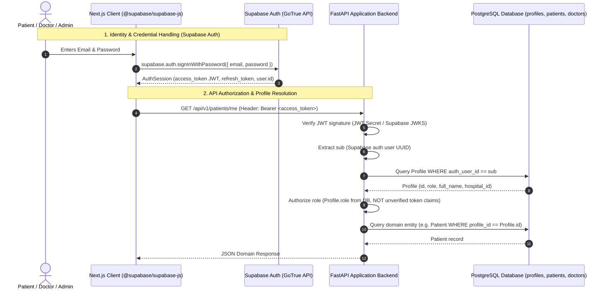
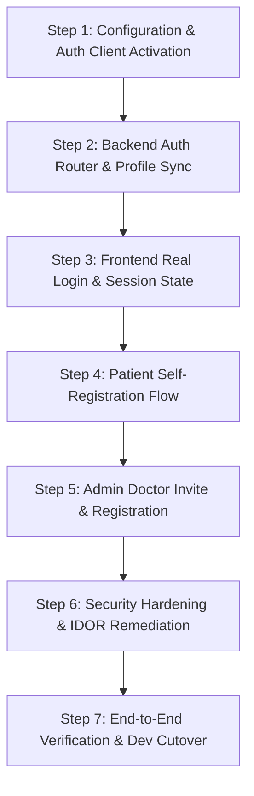

# CareRoute-X — Supabase Auth Integration: Stage 1 Architecture & Migration Plan

**Date:** October 22, 2026  
**Auditor / Architect:** Antigravity Agentic Pair Programmer  
**Project Root:** `D:\medcon5`  
**Scope:** Stage 1 Architecture Inspection, Security Design, and Implementation Plan for Migrating to Supabase Auth while Retaining FastAPI & PostgreSQL Records  
**Report Destination:** `D:\medcon5\reports\supabase_auth_migration_plan.md`  

---

## Executive Summary

CareRoute-X currently uses a simulated role-based login architecture backed by pre-signed, long-lived JSON Web Tokens stored in browser `localStorage`. Although the application database connects to a remote PostgreSQL instance on Supabase infrastructure, **Supabase Auth is completely disconnected**: the client library explicitly returns `null` on placeholder environment variables, and FastAPI has no authentication endpoints.

This report establishes the complete architecture and phased implementation plan to migrate CareRoute-X to genuine Supabase Auth for identity management, session handling, email verification, and password recovery, while preserving:
1. **FastAPI** as the authoritative application backend.
2. The existing relational **PostgreSQL** schema for clinical records, queues, triage, and appointments.
3. Server-enforced role-based authorization and healthcare data isolation boundaries.

> [!IMPORTANT]
> **Strict Read-Only Status:** This document is an architectural inspection and implementation-planning deliverable. No source code, environment variables, or database records have been modified.

---

## Part 1: Supabase Configuration & Codebase Inspection

### 1.1 Findings Verification

The findings from the prior authentication audit were verified directly against the active codebase:

1. **Supabase Auth is Disconnected:**
   * **File:** [`src/lib/supabase/client.ts:L9-16`](file:///D:/medcon5/src/lib/supabase/client.ts#L9-L16)
   * The client factory returns `null` because `NEXT_PUBLIC_SUPABASE_URL` in [`.env.local:L1`](file:///D:/medcon5/.env.local#L1) is set to `"https://placeholder-project.supabase.co"`. No network requests can reach Supabase GoTrue Auth services.
2. **Login Form Ignores User Input:**
   * **File:** [`src/app/(auth)/login/page.tsx:L57-63`](file:///D:/medcon5/src/app/(auth)/login/page.tsx#L57-L63)
   * The `handleSubmit` handler discards entered email and password credentials, executing `loginAsRole(selectedRole)` after a 400ms timeout.
3. **Static Demo JWTs in Browser LocalStorage:**
   * **File:** [`src/services/auth/index.ts:L50-85`](file:///D:/medcon5/src/services/auth/index.ts#L50-L85)
   * Hardcoded dev tokens (`NEXT_PUBLIC_DEV_AUTH_TOKEN`, `NEXT_PUBLIC_DEV_DOCTOR_AUTH_TOKEN`, `NEXT_PUBLIC_DEV_ADMIN_AUTH_TOKEN`) with expiration timestamps reaching year 2027 are written to `localStorage`.
4. **Automatic Unauthenticated Demo Login:**
   * **File:** [`src/services/auth/index.ts:L74-78`](file:///D:/medcon5/src/services/auth/index.ts#L74-L78)
   * The `AuthService` constructor auto-authenticates any first-time visitor as patient `Sarah Jenkins` (`pat_101`) without prompting for credentials.
5. **FastAPI Authorization Dependencies:**
   * **File:** [`backend/app/core/dependencies.py:L85-104`](file:///D:/medcon5/backend/app/core/dependencies.py#L85-L104)
   * Enforces role checks (`require_patient`, `require_doctor`, `require_admin`) by reading the `role` claim from decoded JWT payloads.
6. **Incomplete Registration Workflows:**
   * No patient self-registration endpoint or UI page exists.
   * `POST /api/v1/doctors` exists in the backend but requires a pre-existing `profile_id`. No endpoint exists to create profiles, assign specialties, or add schedules.
7. **Database Architecture:**
   * **File:** [`backend/.env:L1`](file:///D:/medcon5/backend/.env#L1)
   * Configured with a direct PostgreSQL connection string targeting a hosted Supabase pooler (`aws-0-ap-south-1.pooler.supabase.com:5432/postgres`).
   * Fallback in [`backend/app/core/config.py:L35`](file:///D:/medcon5/backend/app/core/config.py#L35) is `sqlite:///./careroute.db`.

### 1.2 Evaluation of Existing Supabase Configuration

Connecting to a Supabase-hosted PostgreSQL database via SQLAlchemy pooler does **not** mean Supabase Auth is enabled or configured.
* **Frontend Gap:** `NEXT_PUBLIC_SUPABASE_URL` and `NEXT_PUBLIC_SUPABASE_ANON_KEY` in `.env.local` are dummy placeholder strings.
* **Backend Gap:** `SUPABASE_JWT_SECRET` is completely missing from `backend/.env`. As a result, [`backend/app/core/config.py:L31`](file:///D:/medcon5/backend/app/core/config.py#L31) falls back to the insecure string `"your-supabase-jwt-secret-placeholder-for-dev"`.
* **Conclusion:** The current Supabase configuration is **insufficient** for real authentication. The project owner must provide authentic Supabase project credentials before live Auth can function.

---

## Part 2: Proposed Authentication & Registration Architecture

### 2.1 Architectural Overview



### 2.2 Core Architectural Principles

1. **Supabase Auth Responsibilities:**
   * Supabase Auth manages credential storage (bcrypt/Argon2), password salting, JWT issuing, refresh token rotation, email verification links, and password reset flows.
2. **FastAPI Responsibilities:**
   * FastAPI does not store or process passwords.
   * FastAPI intercepts every HTTP request via `get_current_user`, validates the JWT cryptographically, extracts `sub` (`auth_user_id`), and resolves the user's authoritative `Profile` from PostgreSQL.
3. **Server-Authoritative Roles (No Client Claim Trust):**
   * While Supabase JWTs can store user metadata, **FastAPI must resolve the user's role directly from the database `profiles.role` column**. This guarantees that a user cannot escalate their privileges by tampering with client-side token metadata.
4. **Strict Public Registration Guardrails:**
   * Public self-registration (sign-up) is restricted strictly to the **`PATIENT`** role.
   * Doctor and Admin accounts can never be created via public sign-up.

---

### 2.3 Explicit 3-Tier Identity Mapping

A critical design requirement is maintaining clear separation between identity identifiers:

```
[ Tier 1: Identity Provider ]
Supabase Auth User (auth.users.id: UUID)
          │
          │ maps 1:1 via profiles.auth_user_id
          ▼
[ Tier 2: Application Profile ]
Application Profile (profiles.id: UUID, role: UserRole)
          │
          ├──────────────────────────────┐
          │ (when role == PATIENT)        │ (when role == DOCTOR)
          ▼                              ▼
[ Tier 3A: Patient Domain ]    [ Tier 3B: Doctor Domain ]
Patient (patients.id: UUID)    Doctor (doctors.id: UUID)
  - date_of_birth                - license_number
  - emergency_contact            - department_id
  - preferred_language           - hospital_id
```

| Identifier | Source Table | Purpose | Referenced By |
| :--- | :--- | :--- | :--- |
| `auth_user_id` | Supabase Auth (`auth.users.id`) | External authentication subject identifier in JWT `sub` claim. | `profiles.auth_user_id` |
| `profile_id` | `profiles.id` | Application profile primary key representing human user info (name, email, role). | `patients.profile_id`, `doctors.profile_id` |
| `patient_id` | `patients.id` | Clinical patient record identifier. | `appointments.patient_id`, `queue_entries.patient_id`, `triage_sessions.patient_id` |
| `doctor_id` | `doctors.id` | Clinical practitioner record identifier. | `appointments.doctor_id`, `queue_entries.doctor_id`, `doctor_schedules.doctor_id`, `doctor_specialties.doctor_id` |

> [!WARNING]
> Under no circumstances should `auth_user_id` or `profile_id` be passed directly into `appointments.patient_id` or `appointments.doctor_id`. The application must always resolve `auth_user_id` $\rightarrow$ `profile_id` $\rightarrow$ `patient_id` / `doctor_id`.

---

### 2.4 Doctor Onboarding Workflow (Invited & Verified)

```mermaid
graph TD
    Admin["Hospital Admin (Admin Console)"] -->|"POST /api/v1/admin/doctors/invite"| API["FastAPI Admin Router"]
    API -->|"1. Verify caller has role=ADMIN"| AuthCheck{"Admin Verified?"}
    AuthCheck -->|No| Reject["403 Forbidden"]
    AuthCheck -->|Yes| SupaAdmin["2. Supabase Admin API: invite_user_by_email()"]
    SupaAdmin -->|"Issues invite email with secure setup link"| DoctorEmail["Physician's Email Inbox"]
    SupaAdmin -->>|"Returns generated auth_user_id"| API
    API -->|"3. Atomic DB Transaction"| DBTrans[("PostgreSQL Transaction")]
    DBTrans -->|"Create Profile (role=DOCTOR)"| P["profiles"]
    DBTrans -->|"Create Doctor (is_active=False)"| D["doctors"]
    DBTrans -->|"Assign DoctorSpecialty"| DS["doctor_specialties"]
    DBTrans -->|"Assign DoctorSchedule"| DSC["doctor_schedules"]
    DBTrans -->|"Commit Transaction"| Done["Registration Staged"]
    DoctorEmail -->|"Physician sets password"| ActiveAuth["Supabase Auth Verified"]
    Admin -->|"Reviews medical license & activates"| SetActive["Doctor.is_active = True"]
```

1. **Separation of Credential Verification and Account Activation:**
   * When an admin registers/invites a physician, the `Doctor` record is created with `is_active = False`.
   * The doctor cannot be recommended in patient triage, cannot accept appointments, and cannot open queue stations until an administrator verifies their credentials and toggles `is_active = True`.

---

### 2.5 Patient Self-Registration Workflow

1. Patient fills out signup form on `/register` (Full Name, Email, Password, Date of Birth, Phone, Preferred Language).
2. Frontend calls `supabase.auth.signUp({ email, password })`.
3. Supabase creates the user in `auth.users`, assigns a UUID, and sends an email verification link (if email confirmation is enabled).
4. Frontend receives the session access token and immediately calls the new endpoint:
   `POST /api/v1/auth/complete-patient-profile`
   Payload: `{ date_of_birth, full_name, phone, preferred_language, emergency_contact }`.
5. FastAPI validates the token, extracts `sub`, verifies no profile exists for this `auth_user_id`, and executes an atomic transaction creating both `Profile` (`role=PATIENT`) and `Patient` records.

---

## Part 3: Security Requirements & Production Hardening

### 3.1 Eliminating Insecure Development Artifacts

1. **Removal of Automatic Demo Login:**
   * In [`src/services/auth/index.ts:L74-78`](file:///D:/medcon5/src/services/auth/index.ts#L74-L78), delete the fallback auto-login. If no active session exists, the user is strictly `null` and protected routes redirect to `/login`.
2. **Restricting Demo Role Switchers to Development:**
   * Wrap all persona switching buttons in `process.env.NODE_ENV === "development"` guards so they are completely eliminated from production builds.
3. **Elimination of Long-Lived Static Tokens:**
   * Remove `NEXT_PUBLIC_DEV_AUTH_TOKEN`, `NEXT_PUBLIC_DEV_DOCTOR_AUTH_TOKEN`, and `NEXT_PUBLIC_DEV_ADMIN_AUTH_TOKEN` from `.env.local` and `src/services/auth/index.ts`. All tokens must be standard, short-lived (1 hour) tokens issued by Supabase Auth with automatic refresh.
4. **Backend JWT Validation Hardening:**
   * Replace fallback placeholder secrets with strict startup validation: if `ENVIRONMENT == "production"` and `SUPABASE_JWT_SECRET` is unset or contains `"placeholder"`, FastAPI must raise an immediate `RuntimeError` during lifespan startup and refuse to start.
   * Support asymmetric JWKS validation (`https://<project-ref>.supabase.co/auth/v1/.well-known/jwks.json`) for zero-secret public key verification if the Supabase project uses RS256/ES256.

### 3.2 Closing Identified Vulnerabilities

1. **Remediating the Patient Data IDOR (`GET /api/v1/patients/{patient_id}`):**
   * **File:** [`backend/app/api/v1/patients.py:L58-60`](file:///D:/medcon5/backend/app/api/v1/patients.py#L58-L60)
   * **Fix:** Enforce hospital tenant boundaries and care-team relationships for doctors:
     ```python
     if current_user.is_doctor:
         verify_hospital_access(patient.profile.hospital_id, current_user)
         # Optionally verify doctor has an active appointment or queue entry with this patient
     ```
2. **Database Schema Email Uniqueness:**
   * Currently, `Profile.email` has `unique=False`. In PostgreSQL, add a unique index:
     `CREATE UNIQUE INDEX uq_profiles_email ON profiles(LOWER(email));`
   * This guarantees that duplicate profiles cannot be registered with case variations of the same email address.

---

## Part 4: Preserving Existing Functionality

The following existing, database-driven workflows will remain completely operational throughout and after the migration:

1. **Patient Triage & LLM Reasoning:**
   * Unaltered. Triage sessions link to `patients.id`. The caller's `auth_user_id` maps to the patient record exactly as it does now.
2. **Doctor Recommendation Engine:**
   * Unaltered. Scores candidate physicians based on `doctors`, `doctor_schedules`, `doctor_specialties`, ratings, and live queue wait times.
3. **Appointment Booking & Cancellation:**
   * Unaltered. Slot generation, past-slot blocking, and calendar collision checks query `appointments` and `doctor_schedules` by `doctor_id` and `patient_id`.
4. **Live Queue & Doctor Consultations:**
   * Unaltered. Queues track entries by `queue_entries.doctor_id`. Doctor identity is resolved via `_get_authenticated_doctor(db, current_user)` which maps `current_user.id` (`auth_user_id`) to `Doctor`.
5. **Admin Physician Directory:**
   * Unaltered. Reads `doctors` with joined profiles via `GET /api/v1/doctors/admin/list`.
6. **Development Seed Accounts Compatibility:**
   * `backend/app/db/seed_dev.py` will be retained for local test environments (`ENVIRONMENT=development`). In dev mode, `seed_dev.py` can either seed local mock auth identities or use the Supabase Admin API to seed development accounts in the remote auth schema.

---

## Part 5: Implementation Plan

### 5.1 Required Supabase Configuration (Variable Names Only)

The project owner must retrieve the following configuration values from their Supabase Project Dashboard (`Project Settings -> API` and `Project Settings -> API -> JWT Settings`):

#### Frontend (`.env.local`):
* `NEXT_PUBLIC_SUPABASE_URL`: Authentic Supabase project URL (e.g. `https://<project-id>.supabase.co`).
* `NEXT_PUBLIC_SUPABASE_ANON_KEY`: Authentic public anonymous key.
* `NEXT_PUBLIC_API_URL`: Backend URL (`http://localhost:8000` in dev).

#### Backend (`backend/.env`):
* `SUPABASE_URL`: Authentic Supabase project URL.
* `SUPABASE_ANON_KEY`: Authentic public anonymous key.
* `SUPABASE_JWT_SECRET`: Authentic project JWT secret for signature verification.
* `SUPABASE_SERVICE_ROLE_KEY`: Service role secret (kept secure on backend only) required for administrator invites (`supabase.auth.admin.invite_user_by_email`).
* `DATABASE_URL`: Hosted PostgreSQL connection string (already configured).

---

### 5.2 Files Requiring Modification

| File Path | Role in Migration |
| :--- | :--- |
| `src/lib/supabase/client.ts` | Re-enable live client factory using valid `NEXT_PUBLIC_SUPABASE_URL` and `NEXT_PUBLIC_SUPABASE_ANON_KEY`. |
| `src/context/AuthContext.tsx` | Rewrite to bind to `supabase.auth.onAuthStateChange()`, manage live session state, and synchronize token with API client headers. |
| `src/services/auth/index.ts` | Remove mock users and static tokens; delegate `login`, `logout`, `signUp`, and `resetPassword` to `supabase.auth`. |
| `src/app/(auth)/login/page.tsx` | Connect email and password form inputs to `authService.login(email, password)`. Add error handling for bad credentials. |
| `src/app/(auth)/register/page.tsx` | **New Page:** Build patient self-registration form. |
| `backend/app/core/config.py` | Add production assertion that `SUPABASE_JWT_SECRET` is not default placeholder. |
| `backend/app/core/dependencies.py` | Enhance `get_current_user` to resolve role from database `Profile.role` rather than unverified JWT claims. |
| `backend/app/api/v1/auth.py` | **New Router:** Endpoints for `POST /api/v1/auth/complete-patient-profile` and profile synchronization. |
| `backend/app/api/v1/doctors.py` | Add admin composite registration/invite endpoint (`POST /api/v1/doctors/admin/register`). |
| `backend/app/api/v1/patients.py` | Fix IDOR on `GET /api/v1/patients/{patient_id}` by adding tenant verification for doctors. |
| `src/app/admin/doctors/page.tsx` | Add "Register Physician" modal allowing administrators to invite and configure new doctors. |

---

### 5.3 Phased Implementation Steps



#### Step 1: Configuration & Auth Client Activation
* Re-enable `src/lib/supabase/client.ts` to return an active `SupabaseClient` instance when authentic credentials are present.
* Verify token parsing and session listener capabilities.

#### Step 2: Backend Auth Router & Profile Synchronization
* Create `backend/app/api/v1/auth.py`.
* Implement `POST /api/v1/auth/complete-patient-profile`:
  * Protected by valid Supabase JWT.
  * Checks if `Profile` already exists for `auth_user_id`.
  * Inserts `Profile` (`role=PATIENT`) and `Patient` in a single transaction.
* Register `auth.router` in `backend/app/api/v1/router.py`.

#### Step 3: Frontend Real Login & Session Synchronization
* Update `AuthContext.tsx` to subscribe to `supabase.auth.onAuthStateChange`:
  * On `SIGNED_IN`, store access token and fetch current profile from backend.
  * On `SIGNED_OUT`, clear local tokens and redirect to `/login`.
* Update [`src/app/(auth)/login/page.tsx`](file:///D:/medcon5/src/app/(auth)/login/page.tsx) to execute `supabase.auth.signInWithPassword({ email, password })`. Display meaningful error messages (e.g. "Invalid credentials").

#### Step 4: Patient Self-Registration Flow
* Create `src/app/(auth)/register/page.tsx`.
* Wire registration form to `supabase.auth.signUp`, followed immediately by calling `/api/v1/auth/complete-patient-profile`.
* Direct newly registered patients directly to `/patient/dashboard`.

#### Step 5: Admin Doctor Invite & Registration
* Implement `POST /api/v1/doctors/admin/register` in `backend/app/api/v1/doctors.py`:
  * Uses `supabase.auth.admin.invite_user_by_email` (or creates user with temp password).
  * Creates `Profile` (`role=DOCTOR`), `Doctor` (`is_active=False`), `DoctorSpecialty`, and `DoctorSchedule` atomically.
* Add a modal on `src/app/admin/doctors/page.tsx` for entering doctor details.

#### Step 6: Security Hardening & IDOR Remediation
* Patch `GET /api/v1/patients/{patient_id}` in `backend/app/api/v1/patients.py` to check `verify_hospital_access`.
* Remove all static dev tokens and gate role-switchers behind `process.env.NODE_ENV === "development"`.
* Enforce unique constraint on `Profile.email` in database.

#### Step 7: End-to-End Verification & Dev Cutover
* Execute automated test suites for login, registration, role boundaries, appointment booking, and queue management.

---

### 5.4 Rollback & Compatibility Strategy

To ensure zero downtime or breaking changes during migration:
1. **Feature Flag (`NEXT_PUBLIC_AUTH_PROVIDER`):**
   * Implement a feature flag: `NEXT_PUBLIC_AUTH_PROVIDER=supabase` vs `NEXT_PUBLIC_AUTH_PROVIDER=demo`.
   * When set to `demo`, the system retains the existing static tokens for local demonstrations and offline test suites.
   * When set to `supabase`, real Supabase Auth workflows are activated.
2. **Database Backward Compatibility:**
   * Existing seeded accounts (`pat_101`, `doc_202`, `adm_303`) remain in the database.
   * If desired, the project owner can create corresponding users in Supabase Auth with these exact UUIDs or emails to seamlessly link existing clinical history.

---

### 5.5 Test Matrix for Verification

| Test Category | Target Workflow | Success Criteria |
| :--- | :--- | :--- |
| **Authentication** | Valid login with correct credentials | Returns 200, sets session, redirects to role dashboard. |
| **Authentication** | Invalid login with wrong password | Returns 400 with user-friendly error; no session established. |
| **Authentication** | Session expiration | Expired token returns 401; client attempts refresh or redirects to login. |
| **Registration** | Patient self-registration | Creates `auth.users`, `profiles`, and `patients` records; logs in automatically. |
| **Registration** | Public registration privilege check | New user cannot assign themselves `doctor` or `admin` role. |
| **Doctor Registration** | Admin creates doctor | Creates doctor, profile, schedule, and specialties; doctor is staged with `is_active=False`. |
| **Authorization** | Patient accesses doctor route | Returns 403 `INSUFFICIENT_ROLE_PERMISSIONS`. |
| **Authorization** | Doctor accesses another hospital's patient | Returns 403 `CROSS_HOSPITAL_FORBIDDEN`. |
| **Data Integrity** | Patient books appointment | Booking attaches `patients.id` and `doctors.id`; appears in live queue upon check-in. |

---

### 5.6 Decisions & Items Requiring Human Approval

The project owner must approve the following decisions before Step 1 implementation:

1. **Email Confirmation Requirement:**
   * *Decision:* Should newly registered patients be required to click an email verification link before logging in, or should they be signed in immediately upon registration? (Immediate sign-in is recommended for prototype/final-year demo environments; email confirmation is recommended for live clinical production).
2. **Doctor Credentialing Policy:**
   * *Decision:* When an admin creates a doctor, should Supabase send an automated email invite (`invite_user_by_email`), or should the administrator set a temporary password that the doctor changes on first login?
3. **Provision of Authentic Supabase Credentials:**
   * *Action Required:* The project owner must generate and supply authentic values for `NEXT_PUBLIC_SUPABASE_URL`, `NEXT_PUBLIC_SUPABASE_ANON_KEY`, and backend `SUPABASE_JWT_SECRET` / `SUPABASE_SERVICE_ROLE_KEY`.
